# GlucoTwin — Team Kryptonite (VESIT)
[](https://github.com/Avi36005/DigitalTwin-Challenge-Kryptonite/actions/workflows/ci.yml)

**Personalized glucose forecasting between clinic visits · Digital Twin Challenge 2026 (Happiest Health) · student
research prototype.** GlucoTwin keeps a patient-specific state for an adult with Type 2 diabetes, updates it as
continuous-glucose and wearable readings arrive, forecasts glucose 30 and 60 minutes ahead and warns of a new sustained
high-glucose episode, while showing a clinician exactly what was known at each moment. The demo model reads a
baseline profile (EHR-like demographics and screening labs) and the glucose and wearable streams together. Every result
below was measured on recorded CGM data from real people; none comes from simulated patients.

*Hypothetical example (an illustration, not a deployment):* a diabetes educator in Mumbai follows adults with Type 2
diabetes who wear CGMs between quarterly visits, and opens one person's replay to see the forecasts, any warning and the
data behind it ([use case](#5-healthcare-use-case)).

## Results at a glance

Each row names the model and the setting it was evaluated in; they are different models and different tests. Mean
absolute error (MAE) is in mg/dL, averaged equally over participants: an average error, not an accuracy percentage.

| Result | Model | Evaluated on |
|---|---|---|
| MAE **12.96 / 20.26** at 30 / 60 min (persistence 14.84 / 23.23) | **Demo model**: fusion LightGBM with patient adaptation | Later recordings of the **same 14 CGMacros people it was trained on**; a test over time, not on new patients (retrospective, [details](#7-ai-and-ml-model-details)) |
| **61 of 64** new high-glucose onsets warned; **40 false alarms, 1.49 per observed patient-day**; median forecast lead 30 min; the warning is active at 11.8 % of eligible times, not an always-on alarm ([time in warning](reports/warning_time_share.md)) | **Demo model**, 60-minute warning | Same as the row above |
| Prediction ranges (target 80 %) covered **74.2 % / 74.0 %**: under-coverage (the research procedure, calibrated on people held out, covered 80.1 % / 78.8 %; [§7](#7-ai-and-ml-model-details)) | **Demo model** | Same as the row above |
| MAE **13.88 / 22.30** (persistence 15.34 / 24.47) | Research candidate procedure (Ridge on CGM only, chosen in 4 of 5 folds), **not** the demo model | 14 CGMacros people, **each held out entirely** once (nested experiment) |
| MAE **11.15 / 20.11** (persistence 12.14 / 20.44; the 60-minute difference is inconclusive) | A separate 15-minute LightGBM, **not** the demo model | **98 ShanghaiT2DM people**, an independent cohort, evaluated once |
| **Two hours ahead:** MAE **30.6** at 120 min (persistence 35.9; better for 14 of 14 people); 2-hour warning: **315 of 329** onsets at **1.62** false alarms per observed day, median forecast lead 15 min (IQR 5–65); ranges covered 76.5 % (target 80 %) | Research procedure (rule's choice per fold, CGM-only Ridge or LightGBM), **not** the demo model | 14 CGMacros people, **each held out entirely** once; declared before any fit on 20 Oct ([two-hour benchmark](reports/two_hour_benchmark.md), D-043) |
| **Two hours ahead, independent cohort:** MAE **29.55** at 120 min (persistence 31.68; −2.12 [−2.67, −1.53] mg/dL, better for **78 of 98** people); 10.90 / 19.31 at 30 / 60 min (persistence 12.14 / 20.44); ranges covered 87 % | A 15-minute LightGBM on CGM only, re-fitted with a 120-minute horizon (`gt-2h-ext-2026-10-20`; a separate fit from the row above), **not** the demo model | **98 ShanghaiT2DM people**, assessed once; no 120-minute result had been computed there before (declared before any fit, [external two-hour check](reports/two_hour_external.md), D-045) |

Scores depend on the dataset, prediction task and evaluation protocol; performance on simulated patients does not
establish performance on real patients.

**Why 14 people.** The brief asks for one condition, so every result is on people with Type 2 diabetes: the 14 in
CGMacros' Type 2 group (its other 31 participants have pre-diabetes or no diabetes and are outside the intended
population) and 98 ShanghaiT2DM people as an independent external check ([data card](docs/data_card.md)).

Research demonstration only: not a medical device, no treatment advice, and a replay of recorded or synthetic data,
never a live device. The demo model was chosen to meet the brief's fusion requirement, under a constraint declared
**after** the test segment had been inspected; we have **not** established that the profile improves forecasts for
unseen patients ([the three models](#the-three-models-behind-these-numbers) ·
[what the fusion does and does not show](#what-the-profile-fusion-does-and-does-not-show)).

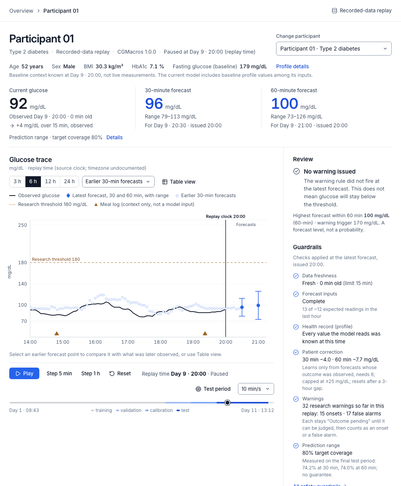

*Recorded CGMacros data (de-identified), Participant 01, final test period: later recordings of a participant
represented in training, replayed 5 minutes at a time (not a live device). A research warning is issued at Day 9 ·
20:30 while its outcome is pending; the onset follows at 20:45 (forecast lead 15 min). The same participant had two
false alarms earlier that day (09:15 and 11:25), and across the test 40 of 101 warning episodes were false alarms (1.49 per
observed patient-day). Re-record with `make demo-gif` (needs ffmpeg).*

## Safety guardrails

Built into the code and covered by tests, not just stated:

| Guardrail | What it does | Where |
|---|---|---|
| **Abstains instead of guessing** | No forecast is issued with less than 60 min of history or fewer than half the expected readings in the last hour, and none without a new reading; after 15 min without one, the last forecast is shown marked *Stale*. The app shows the reason. | [`features.py`](ml/glucotwin/features.py) · [`test_replay_api.py`](tests/test_replay_api.py) |
| **Flags weak inputs** | A forecast is marked *Degraded*, with reasons, after a gap longer than 15 min, an incomplete last hour, a reading at the sensor limit (40 or 400 mg/dL) or a missing wearable summary. | [`features.py`](ml/glucotwin/features.py) |
| **Fusion model needs its health record** | The profile model was trained on complete profiles only, so it abstains when a profile value is missing or not yet available. | [`test_leakage.py`](tests/test_leakage.py) |
| **No look-ahead** | Only native sensor readings are used, never the dataset's interpolated 1-minute rows. Labs, meals and wearable summaries enter only after the time they became available. | [`data_card.md`](docs/data_card.md) · [`test_leakage.py`](tests/test_leakage.py) |
| **Bounded personalisation** | The per-patient correction learns only from forecasts whose outcome has been observed, needs at least 6 of them, is capped at ±25 mg/dL and resets after a 3-hour gap. | [`adaptation.py`](ml/glucotwin/models/adaptation.py) |
| **Implausible data rejected** | Readings outside the device's reporting range and impossible timestamps are marked invalid and never used; readings at the limit are marked suspect. | [`cgmacros.py`](ml/glucotwin/data/cgmacros.py) · [`canonical.py`](ml/glucotwin/data/canonical.py) |
| **Every warning shows its outcome** | Each warning is labelled *Research warning*, stays *Outcome pending* until it can be judged, and is then matched to an onset, counted as a false alarm or marked *Outcome unknown (gap)* when missing data hides the outcome. Firings within 30 min merge into one episode, so one rise cannot flood the screen. The false-alarm rate is published next to the hit rate. | [`alerts.py`](ml/glucotwin/evaluation/alerts.py) |
| **Uncertainty shown** | Every forecast carries an 80 % prediction range, and the app states the measured coverage (74 %). | [Results at a glance](#results-at-a-glance) |
| **No clinical claims** | Research demonstration only: not a medical device, no treatment advice, a replay and never a live device. | [Help & demo guide](apps/web/src/components/shell/Dialogs.tsx) |
| **Tests cannot be quietly re-run** | An opened test writes a lock file; re-running needs a written reason and is then marked exploratory. Research runs cannot change the demo model; promotion and rollback are separate, explicit commands. | [`assess.py`](ml/glucotwin/research/assess.py) · [`promote.py`](ml/glucotwin/research/promote.py) |
| **App matches the evaluation** | Replaying every test participant through the app reproduced all 15,440 saved test forecasts within 0.05 mg/dL. | [`verification.md`](reports/verification.md) |

## Submission checklist (Unstop form)

The twelve mandatory items, where each is answered below, and its status on **20 October 2026**. Status is updated
only when the evidence exists; details and owners: [`docs/submission_checklist.md`](docs/submission_checklist.md).

| # | Form item | Section | Status |
|---|---|---|---|
| 1 | Team details | [Team details](#1-team-details) | Ready |
| 2 | College / incubator information | [College or incubator](#2-college-or-incubator-information) | Ready |
| 3 | Project title | [Project title](#3-project-title) | Ready |
| 4 | Problem statement | [Problem statement](#4-problem-statement) | Ready |
| 5 | Healthcare use case | [Healthcare use case](#5-healthcare-use-case) | Ready |
| 6 | Technical stack | [Technical stack](#6-technical-stack) | Ready |
| 7 | AI/ML model or framework details | [AI and ML model details](#7-ai-and-ml-model-details) | Ready |
| 8 | Demo video (unlisted YouTube, minimum 20 min) | [Demo video](#8-demo-video) | **Missing — not yet recorded or uploaded** |
| 9 | Open-source license details | [Open-source license](#9-open-source-license) | Ready (holder to be confirmed by the team) |
| 10 | Architecture diagram (PDF/PPT) | [Architecture diagram](#10-architecture-diagram) | Ready |
| 11 | Presentation with details and outcomes (PDF/PPT) | [Presentation](#11-presentation) | Ready (video link added after upload) |
| 12 | Files and links accessible without extra permissions | [Accessible files and links](#12-accessible-files-and-links) | **Unverified — repository not yet public** |

## 1. Team details

| | |
|---|---|
| Team name | **Kryptonite** |
| Team leader | Avinash Gehi |
| Members | Avinash Gehi (leader) · Hardik Hinduja |
| Contact | Through the Unstop submission (the leader's contact details are entered on the form, not published here) |

More: [`docs/team_details.md`](docs/team_details.md). Team folder (the challenge's `Team Name_College Name` rule):
[`Kryptonite_VESIT/`](Kryptonite_VESIT/README.md), an index of the submission files.

## 2. College or incubator information

**Vivekanand Education Society's Institute of Technology (VESIT), Mumbai** — Team Kryptonite. No incubator.

## 3. Project title

**GlucoTwin — a personalized Type 2 diabetes glucose digital twin for between-visit monitoring.**

## 4. Problem statement

HbA1c summarises about three months of glucose and cannot show the short high-glucose excursions that happen between
appointments. Continuous glucose monitors can, but they produce about 288 readings a day — far too many for a
clinician to review by hand. Population models also ignore that the same meal or activity affects each person
differently.

GlucoTwin addresses one prediction problem. The twin holds a static baseline profile (EHR-like demographics and
screening labs) and dynamic streams (native CGM readings and wearable heart-rate/activity), using only data
available **up to now**. From these it forecasts glucose **30 and 60 minutes ahead** and warns of a **new episode
above 180 mg/dL sustained for at least 15 minutes** (a research definition, not triage). Each prediction is tied to
the person's own recent forecast errors. The demo forecaster ingests both streams in one model — eight baseline
profile values and 38 glucose and wearable features. Whether the profile helps people outside the training cohort has
not been established (§7).

## 5. Healthcare use case

* **Hypothetical example (an illustration only; no clinic, partner or pilot is involved):** a diabetes educator in
  Mumbai follows adults with Type 2 diabetes who wear CGMs and activity trackers between quarterly visits. One sensor
  produces about 288 readings a day, too many to read by hand. The educator opens one person's replay and sees the
  current reading, the 30- and 60-minute forecasts with their ranges, any research warning with the forecast that fired
  it, and the data each forecast was allowed to use. GlucoTwin reviews one person at a time; it has no multi-patient
  queue, and no Indian participants were evaluated.
* **Who:** a clinician or diabetes educator reviewing a small cohort of adults with Type 2 diabetes who wear CGMs and
  activity trackers between visits; a second user is a reviewer inspecting the evidence.
* **Question answered:** “Which monitored patient's glucose pattern merits review, and what observations support that
  conclusion?”
* **Scope:** research use with recorded (CGMacros) or synthetic data. No insulin or medication advice, no triage, no
  live device connection, no LLM-generated predictions.

**Clinician workflow in the working dashboard**

1. **Open the workspace** from the landing page and click **Open recorded demo** (Participant 01 from the final test
   period, later in that person's recording), or **choose a participant** (Participants page or ⌘K/Ctrl+K search) and start a **New replay** — recorded
   data or the synthetic demonstration; the data mode stays visible.
2. **Read the twin at the replay time:** baseline profile as known at that moment, current glucose, 30/60-minute
   forecasts with a prediction range (target coverage 80 %), and data freshness. An unavailable forecast says why.
3. **Review research warnings:** each names the forecast that fired it and the trigger level, stays *pending* until the outcome is
   knowable, then reports detected (with its forecast lead) or false alarm. *Mark as reviewed* records a local note only.
4. **Inspect a forecast:** information cutoff, model version, population forecast vs patient correction, factual
   explanations (associations, not causes).
5. **Check the evidence:** Model evidence (measured comparison) and Data quality (provenance, cadence, missingness).

| Desktop (1920×1080) — recorded data, a real 70-minute sensor gap: reading and forecasts marked stale | Mobile (375 px) |
|---|---|
| 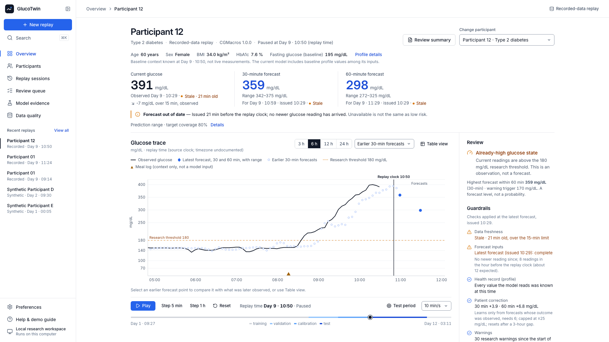 | 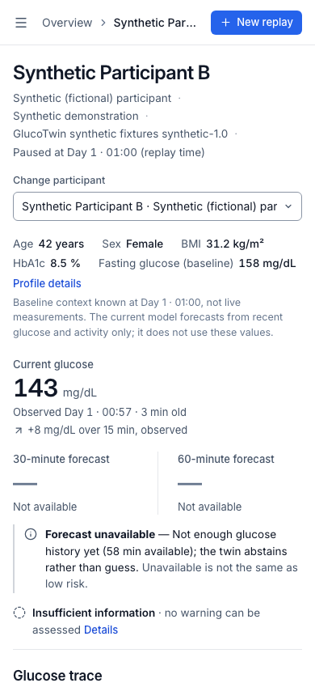 |

### Screens from the working application

Captured by the Playwright journeys (`make e2e`) against the running API — nothing is mocked. Recorded-data screens
show de-identified CGMacros 1.0.0 data (CC BY-NC-SA 4.0); synthetic screens show fictional participants. Full list:
[`reports/ui/README.md`](reports/ui/README.md).

| | |
|---|---|
| 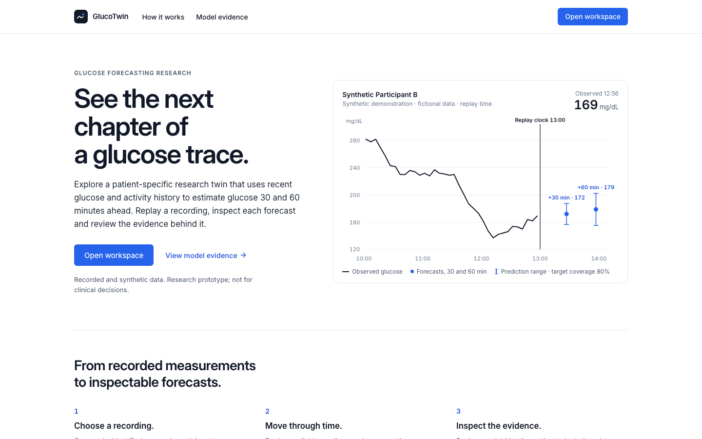 **Landing page** — what GlucoTwin does, with a synthetic preview | 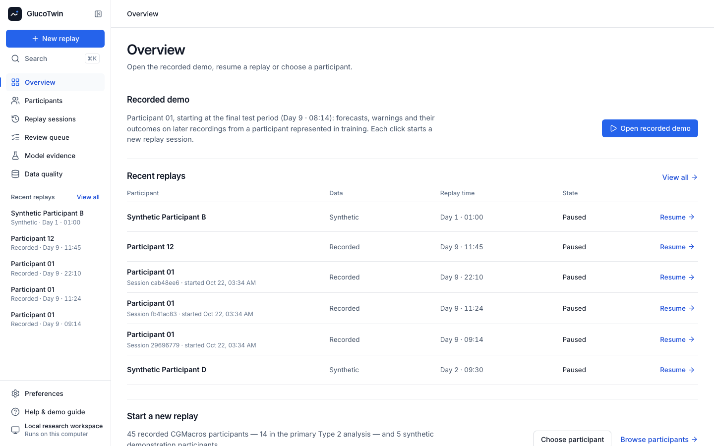 **Overview** — open the recorded demo, resume a replay or choose a participant |
| 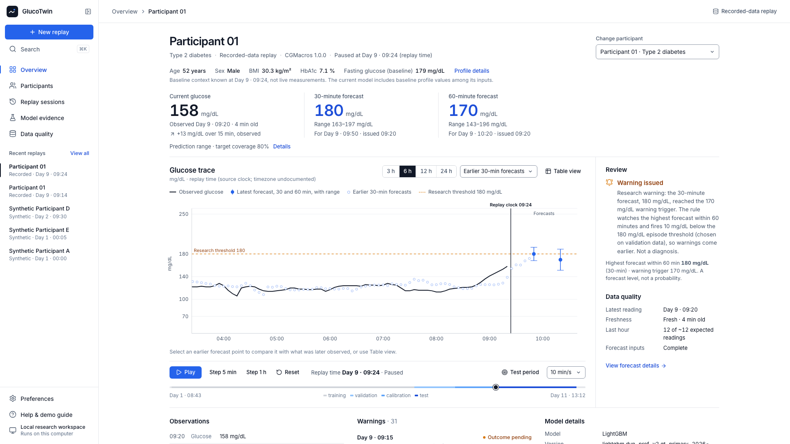 **Recorded replay, Day 9 · 09:24** — 30/60-min forecasts with ranges; research warning issued, outcome pending; the panel names the forecast that fired it | 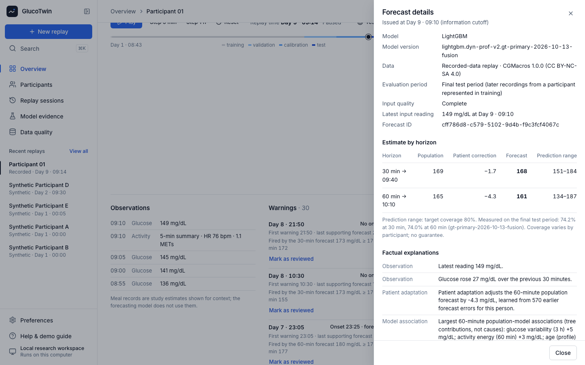 **Forecast details** — information cutoff, model version, population forecast vs patient correction |
| 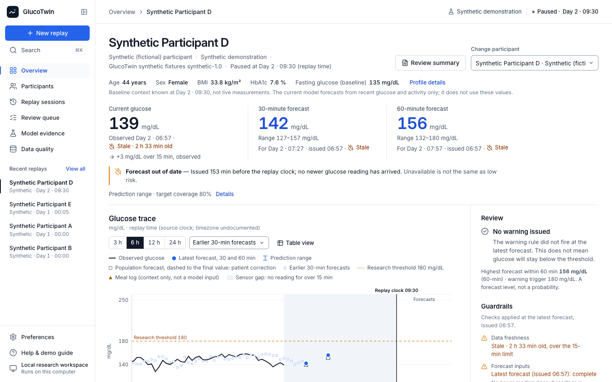 **Sensor gap (synthetic)** — reading and forecast marked out of date | 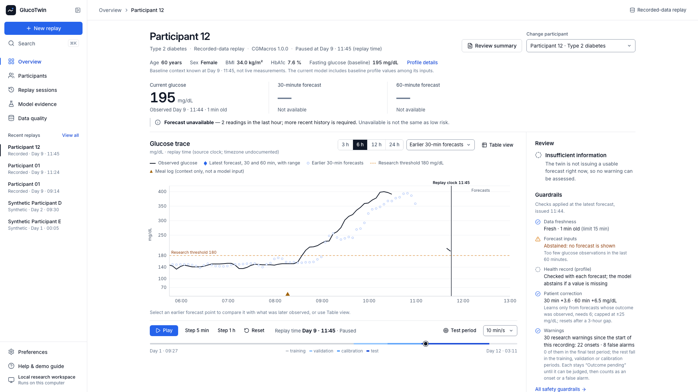 **Abstention** — readings resumed, but too few in the last hour to forecast |
| 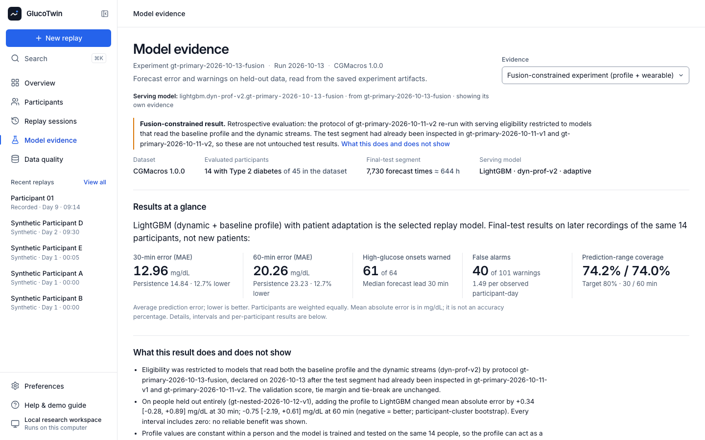 **Model evidence** — the serving model named, results at a glance, and the fusion constraint's disclosures read from the experiment | 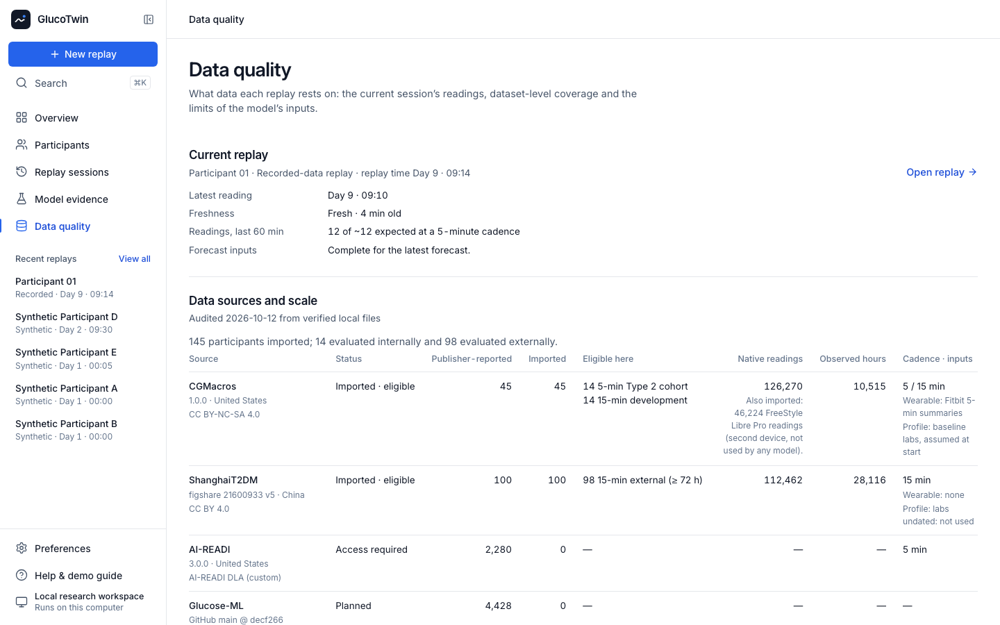 **Data quality** — sources, model-input limits and coverage |
| 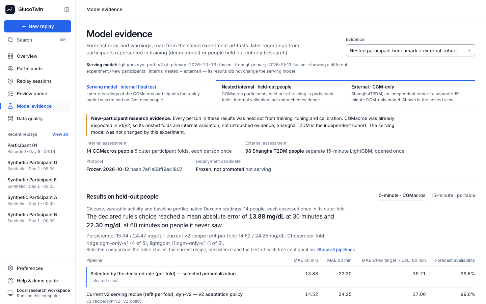 **Research evidence** — results on people held out entirely, kept apart from the demo model | 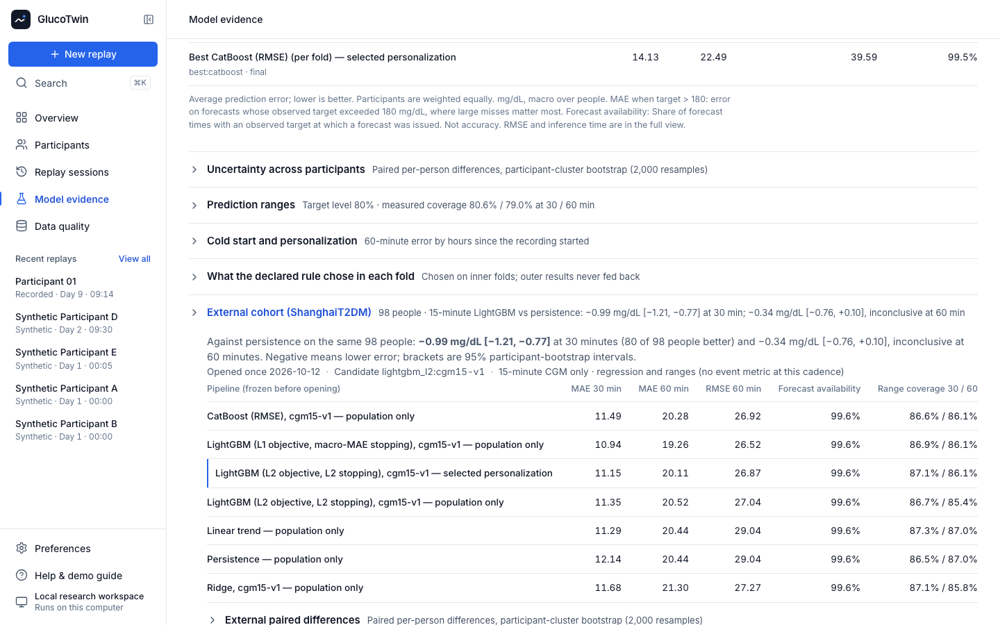 **External cohort** — separate 15-minute model on ShanghaiT2DM |
| 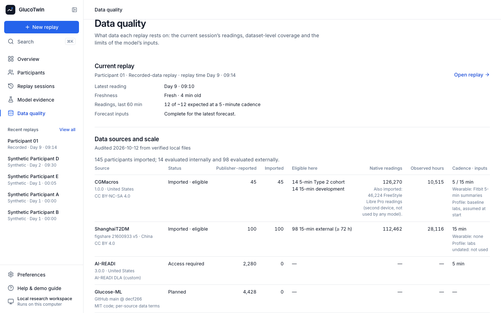 **Data sources and scale** — dataset inventory and access status | 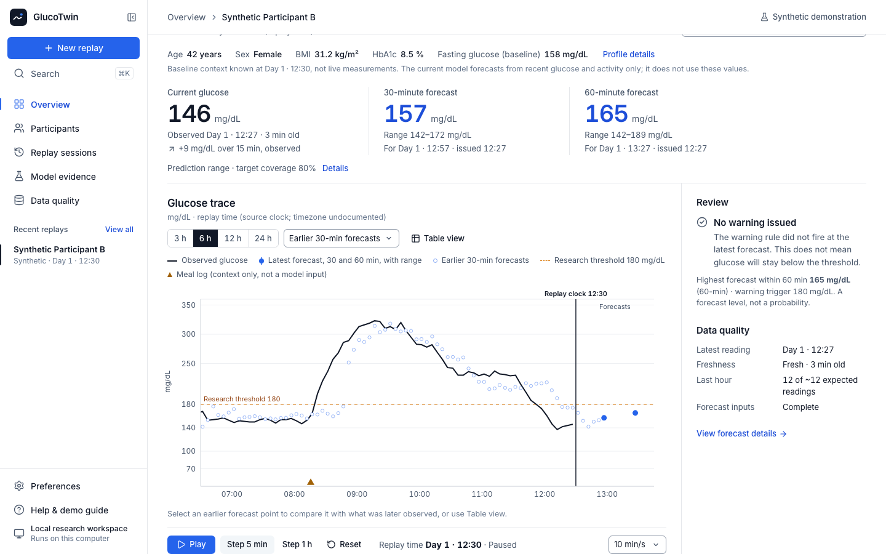 **Synthetic demonstration** — a warning acknowledged after stepping the replay |

Product details: [`docs/product.md`](docs/product.md) · interface handoff: [`docs/frontend-handoff.md`](docs/frontend-handoff.md).

## 6. Technical stack

| Layer | Technologies actually used |
|---|---|
| Data processing | Python 3.12, NumPy, pandas, PyArrow/Parquet, SHA-256-verified acquisition (`uv` for environments) |
| Machine learning | scikit-learn (ridge), **LightGBM 4.7**, **CatBoost 1.2**, split-conformal intervals, TreeSHAP contributions |
| Backend | FastAPI, Pydantic (OpenAPI contract `schema_version 1.0`), SQLite (sessions, issued forecasts, acknowledgements) |
| Frontend | React 19, TypeScript 5.9, Vite, React Router, TanStack Query, Recharts, Lucide icons, Inter (bundled) |
| Testing | pytest, Vitest + Testing Library, Playwright |
| Documents | matplotlib, python-pptx, reportlab |

CPU only; no cloud account, GPU, API key or LLM. Exact versions: `uv.lock`, `apps/web/package-lock.json`.

## 7. AI and ML model details

### The three models behind these numbers

Results come from three separately labelled models, all reproducible with the commands in [Run it locally](#run-it-locally):

* **Current demo model — fusion LightGBM** (`lightgbm.dyn-prof-v2.gt-primary-2026-10-13-fusion`). It serves
  recorded-data replays and reads the static baseline profile together with the glucose and wearable streams, as the
  brief requires. Synthetic replays use a separate, fixed demonstration model (dynamic inputs only, labelled
  synthetic in the app). Its test results come from **later recordings of the same 14 people it was trained on**, not
  from new patients. It was selected by the v2 rule restricted to models that read both, a constraint declared on
  13 Oct 2026 **after** the test segment had been inspected. We selected a model that implements the required fusion;
  we have **not** established that profile features improve forecasting for unseen patients
  ([why](#what-the-profile-fusion-does-and-does-not-show)). The previous demo model, LightGBM v2 on the dynamic
  streams only (`gt-primary-2026-10-11-v2`, the v1 protocol re-run after two code fixes —
  [repair report](reports/repair_report.md)), stays registered for rollback; v1 is preserved.
* **Five-minute candidate — Ridge on CGM-only features** (`ridge.cgm-only-v1.gt-nested-2026-10-12-v1`). Chosen by a
  frozen rule and evaluated on people it never saw (experiment `gt-nested-2026-10-12-v1`). Evaluated, **not promoted**;
  it reads CGM only, so it does not meet the two-stream requirement and is not a replacement for the demo model.
* **External check — a separate 15-minute LightGBM** (`lightgbm.cgm15-v1.gt-nested-2026-10-12-v1`). Trained on
  CGMacros and evaluated once on an independent Chinese cohort; it is not the demo model and not the Ridge candidate.
* **Two-hour research (20 Oct)** — `gt-2h-2026-10-20` (5-minute procedure, 14 people held out), `gt-2h-ext-2026-10-20`
  (15-minute LightGBM re-fitted with a 120-minute horizon, assessed on ShanghaiT2DM) and the rejected classifier
  `gt-2h-clf-2026-10-20`; none is the demo model ([two-hour](reports/two_hour_benchmark.md) ·
  [external](reports/two_hour_external.md) · [classifier](reports/two_hour_classifier.md)).

**145 participants imported; 14 evaluated internally and 98 evaluated externally.**

| Aspect | What was actually done |
|---|---|
| Inputs | Trailing native CGM features (≤ 180 min) and Fitbit heart-rate/activity summaries (each 5-minute summary counts only the part inside the lookback window) — 38 dynamic features; the serving model also reads 8 baseline profile values: age, sex, BMI, HbA1c, fasting glucose and insulin, triglycerides and HDL (each only once available; the model abstains if one is missing). Meals excluded from the primary model (logging time undocumented). Only records with `observed_at` and `available_at` ≤ forecast time |
| Horizons | 30 and 60 minutes (direct per-horizon models) |
| Candidates | Persistence, bounded linear trend, ridge; **LightGBM** and **CatBoost** with identical inputs, origins and 12-trial seeded searches; each on dynamic-only (`dyn-v2`) and profile-augmented (`dyn-prof-v2`) features |
| Personalization | The same causal policy for every tree model: a shrunk, capped, decaying bias learned from the person's own *matured* forecast errors; weights never refit online |
| Protocol | Within-participant chronological split 60/10/10/20 (training / selection / calibration / test) with purge gaps; protocol frozen before fitting; selection, adaptation, split-conformal prediction ranges (target coverage 80 %) and alert threshold chosen without test data. v1 evaluated test once; **v2 re-runs the same protocol after code corrections, on the already-inspected test segment; the fusion experiment re-runs v2 with one change — serving eligibility restricted to models that read the profile and the dynamic streams — declared after that segment had been inspected** |
| Selected (serving) | **LightGBM `dyn-prof-v2` + patient adaptation** (`lightgbm.dyn-prof-v2.gt-primary-2026-10-13-fusion`) — the rule declared in advance (lowest mean validation error; candidates within 0.5 mg/dL tie → simpler model, then smaller feature set), applied only to models that read both the profile and the dynamic streams. It had the lowest validation score (17.36; CatBoost `dyn-prof-v2` tied at 17.44). Without the constraint the rule picks LightGBM `dyn-v2`, the previous demo model |
| Warning | Max forecast within 60 min − 180 mg/dL; an uncalibrated score, never shown as a probability; threshold chosen on validation by event-level F1 (−10 mg/dL for the serving model) |

**Measured results — final test segment, fusion-constrained experiment `gt-primary-2026-10-13-fusion`** (the last
20 % of each recording of the **same 14 people the model was trained on** — a test over time, not on new patients; 14
participants in CGMacros' Type 2 group, 7,730 forecast origins ≈ 644 h, 64 new high-glucose onsets; mean absolute error
averaged equally over participants, in mg/dL — an average error, not an accuracy percentage; 95 % participant-cluster
bootstrap). Every candidate's test predictions are identical to v2's; only the selection, and the adaptation, ranges and
warning threshold derived for the selected model, differ:

| Model | MAE 30 min | MAE 60 min |
|---|---|---|
| Persistence (last reading) | 14.84 | 23.23 |
| Ridge (dynamic + profile) | 14.61 | 22.96 |
| LightGBM dynamic-only + adaptation (previous demo model, v2) | 13.15 | 20.81 |
| LightGBM + profile, population | 13.14 | 20.59 |
| **LightGBM + profile + patient adaptation (serving)** | **12.96** | **20.26** |
| CatBoost + profile + adaptation (tied on validation, not selected) | 12.93 | 19.80 |

* Serving vs persistence: **−1.88 [−2.53, −1.32]** (30 min) and **−2.96 [−4.34, −1.77]** (60 min); better for 14/14
  participants at 30 min and 13/14 at 60 min.
* Patient adaptation: **−0.18 [−0.35, −0.01]** and −0.33 [−0.68, +0.02] mg/dL — small, and inconclusive at 60 min; a
  frozen-state control shows it comes from online updating. New participants (leave-one-participant-out, secondary):
  14.66 / 24.26 → 13.81 / 22.12.
* LightGBM vs CatBoost with the same inputs: no clear difference at 30 min; CatBoost better at 60 min (LightGBM minus
  CatBoost +0.46 [+0.05, +0.92], population models). They tied on validation and the declared tie-break chose LightGBM.
* Early warning (60 min, margin −10 mg/dL): **61/64 onsets detected, precision 0.60 — 40 false alarms, 1.49 per
  observed patient-day** (2.28 per eligible day); qualified forecast lead median **30 min**. The previous demo model
  (margin −30) detected 64/64 with 79 false alarms (2.95 per observed patient-day) and a 55-minute lead: fewer false alarms came with three
  missed onsets and 25 minutes of lead. Both margins come from the same nearly flat F1 curve
  ([next experiment](docs/next_experiment.md)). The same procedure on persistence (fires when glucose reaches 150 mg/dL)
  detected 63/64 with 70 false alarms (2.61 per observed patient-day). The 40 false alarms are 40 of 101 warning
  episodes: a reviewer would still see more than one false alarm per observed patient-day.
* Prediction ranges (target coverage 80 %) covered **74.2 % / 74.0 %** on test, and only 60–82 % (30 min) and
  51–88 % (60 min) per participant — under-coverage, reported as such; the ranges are not calibrated for every person.
* Correction history: v1 (`gt-primary-2026-10-11-v1`, declared before fitting) gave 13.32 / 21.20 mg/dL with 26 false
  alarms; its activity features counted up to 65 minutes in a 60-minute window. v2 (13.15 / 20.81) fixed that. v1 and v2
  artifacts and reports are preserved ([`reports/archive/`](reports/archive/)).
* Not run: the optional Chronos-Bolt foundation-model track.

### What the profile fusion does and does not show

The brief asks for a working model that ingests static EHR-like data and dynamic wearable data. The serving model does:
one LightGBM per horizon reads the 8 profile values and the 38 glucose and wearable features together. What that
establishes, and what it does not:

1. **Within the same 14 people, the profile model scored better.** LightGBM with vs without the profile (population
   models, test): −0.25 [−0.43, −0.04] mg/dL at 30 min and −0.61 [−1.15, −0.09] at 60 min.
2. **That may be identity, not physiology.** Profile values are constant within a person, and the test segment holds
   later days of the same 14 people, so the profile can act as a participant identifier.
3. **On people held out entirely there was no reliable benefit.** Nested experiment, LightGBM `dyn-prof-v2` minus
   `dyn-v2`: +0.34 [−0.28, +0.89] mg/dL at 30 min and −0.75 [−2.19, +0.61] at 60 min. Two hours ahead
   (`gt-2h-2026-10-20`, D-043): −0.86 [−2.60, +1.02] mg/dL, again no reliable benefit; Ridge with the profile was clearly
   worse (+12.65 [+1.34, +29.24]), consistent with the profile acting as an identity code
   ([two-hour benchmark](reports/two_hour_benchmark.md)). An exploratory look (not pre-specified, many comparisons)
   found CatBoost forecasts better with the profile at 120 min (36.72 → 32.70 mg/dL, −4.02 [−6.87, −1.38], 10 of 14
   people), still above the CGM-only choice; LightGBM showed no reliable difference and Ridge got worse
   ([cold-start profile](reports/cold_start_profile.md)).
4. **The constraint was added after the test segment had been inspected** (in v1 and v2), so these are retrospective
   results. The validation score, tie margin and tie-break are unchanged
   ([protocol](configs/experiments/gt-primary-2026-10-13-fusion.yaml), decisions D-038 and D-039 in
   [`docs/decisions.md`](docs/decisions.md)).
5. **Chosen for the brief, not for accuracy.** We selected a model that implements the required fusion; we have not
   established that profile features improve forecasting for unseen patients. The lower false-alarm rate comes with a
   different warning margin and is not evidence that the profile helps.

The dynamic-only model stays registered: `uv run glucotwin research rollback --to
lightgbm.dyn-v2.gt-primary-2026-10-11-v2`, then restart the API.

**Limitations:** 14 participants from one US site; no Indian participants; blinded research CGMs replayed with assumed
zero latency; medication use unknown; ranges under-cover; the warning rule still raises more than one false alarm per
observed day; 180 mg/dL is a research threshold; with 14 people the profile may act as an identity code; v2 and the
fusion constraint re-use an already-inspected test segment. Nothing here is clinical validation.

**New-participant and external evidence (research experiment `gt-nested-2026-10-12-v1`, run on 12 Oct against the
previous demo recipe, LightGBM v2).** 145 participants imported (45 CGMacros, 100 ShanghaiT2DM); 14 evaluated internally and 98 evaluated
externally. A protocol frozen before fitting evaluated every pipeline on people it never saw: five outer participant
folds over the 14 CGMacros Type 2 people (internal validation — that cohort was already inspected) and a reserved
external cohort, ShanghaiT2DM (FreeStyle Libre H at 15-minute cadence, China), opened once.

| Internal: 14 CGMacros people, each held out once (macro MAE, mg/dL) | 30 min | 60 min |
|---|---|---|
| Persistence | 15.34 | 24.47 |
| v2 recipe (previous demo model), refit per fold | 14.52 | 24.25 |
| **Five-minute candidate procedure** — Ridge, CGM-only, v2 adaptation (the rule's choice in 4 of 5 folds; LightGBM L1 in 1) | **13.88** | **22.30** |

| External: 98 ShanghaiT2DM people — separate 15-minute LightGBM vs persistence | 30 min | 60 min |
|---|---|---|
| Persistence | 12.14 | 20.44 |
| 15-minute LightGBM | 11.15 | 20.11 |
| Difference (95 % participant bootstrap interval) | **−0.99 [−1.21, −0.77]**, better for 80 of 98 | −0.34 [−0.76, +0.10], **inconclusive** |

* Chosen pipeline minus v2 recipe: −0.64 [−0.98, −0.32] and −1.95 [−2.83, −1.04] mg/dL; better for 12/14 and 13/14
  people. It is worse when the target exceeds 180 mg/dL (39.71 vs 37.00 mg/dL at 60 min). Wearable activity inputs
  made new-person forecasts worse in this cohort.
* Warnings (60 min, threshold chosen on inner folds for ≤ 2 false alarms per observed forecastable day): 301 of 329
  onsets at 1.31 false alarms per observed day, versus 329 of 329 at 2.80 for the v2 recipe with its −30 margin.
* Ranges (target 80 %) covered 80.1 % / 78.8 % on outer-fold people and 87.1 % / 86.1 % on ShanghaiT2DM (wider than
  needed there). The external 30-minute improvement is clear; at 60 minutes it is not distinguishable from zero. Other
  frozen pipelines had lower external error (lowest: LightGBM L1, 10.81 / 19.00 mg/dL) — reported, not adopted, because
  choosing on the external cohort would make it a tuning set.
* The pre-specified rule of this research protocol recommends switching to the Ridge candidate, but it is worse on large
  highs, its evidence is internal, and it reads CGM only, so it is not eligible under the two-stream requirement the
  demo model now follows. **Nothing from this experiment was promoted** (the 13 Oct change of demo model is the
  separate fusion constraint above). Promotion criteria for the next
  experiment now also bound high-glucose error, missed onsets and false warnings
  ([`configs/experiments/gt-nested-2026-10-12-v2.yaml`](configs/experiments/gt-nested-2026-10-12-v2.yaml), declared, not run) ([model upgrade review](reports/model_upgrade_review.md),
  [full research report](reports/nested_benchmark_report.md), [data expansion audit](reports/dataset_expansion_audit.md)).
  AI-READI was not accessed; no Indian participants were evaluated.

**A negative two-hour result, kept.** A classifier trained directly on "a new onset within two hours" (`gt-2h-clf-2026-10-20`,
D-044, declared before fitting) looked perfect on episode counts (329 of 329 onsets, 0.18 false alarms per day) only
because its inner-fold threshold made it warn at 99 % of eligible times; its ROC AUC was 0.64. It is not used
([report](reports/two_hour_classifier.md)), and it shows why time spent in warning must be read beside alarm counts.

Full results: [`reports/evaluation_report.md`](reports/evaluation_report.md) · corrections:
[`reports/repair_report.md`](reports/repair_report.md) · model card:
[`docs/model_card.md`](docs/model_card.md) · data card: [`docs/data_card.md`](docs/data_card.md).

## 8. Demo video

* **Unlisted YouTube link: not yet available** — the recording has not been made or uploaded.
* The challenge page requires a **minimum 20-minute video** (rechecked 14 Oct 2026); target 20:15 so neither the
  rendered file nor YouTube's displayed duration falls below 20:00. The actual rendered and YouTube-displayed durations
  will be recorded here after upload.
* Recording plan with chapter timestamps: [`docs/demo_script.md`](docs/demo_script.md); replay sequence verified
  against the running app: [`reports/demo_sequence.md`](reports/demo_sequence.md).

## 9. Open-source license

* **Code:** MIT — [`LICENSE`](LICENSE). Copyright holder entered as “Avinash Gehi and Hardik Hinduja (Team
  Kryptonite)”, pending the team's confirmation.
* **Data:** CGMacros 1.0.0 — Gutierrez-Osuna R., Kerr D., Mortazavi B., Das A. *CGMacros: a scientific dataset for
  personalized nutrition and diet monitoring* (version 1.0.0). PhysioNet (2025). https://doi.org/10.13026/3z8q-x658 —
  **CC BY-NC-SA 4.0**. The dataset and model weights trained on it are **not** redistributed here.
* **External check data:** ShanghaiT2DM — Zhao, Zhu, Wang, Rao (2022), figshare,
  https://doi.org/10.6084/m9.figshare.21600933.v5 — **CC BY 4.0**; downloaded by each user, not redistributed here.
* **Synthetic fixtures:** generated by this repository, CC0-1.0. Third-party packages keep their own licenses.

## 10. Architecture diagram

**[`docs/submission/GlucoTwin_Architecture.pdf`](docs/submission/GlucoTwin_Architecture.pdf)** (2 pages: system
architecture; forecast lifecycle, availability boundary and state ownership).

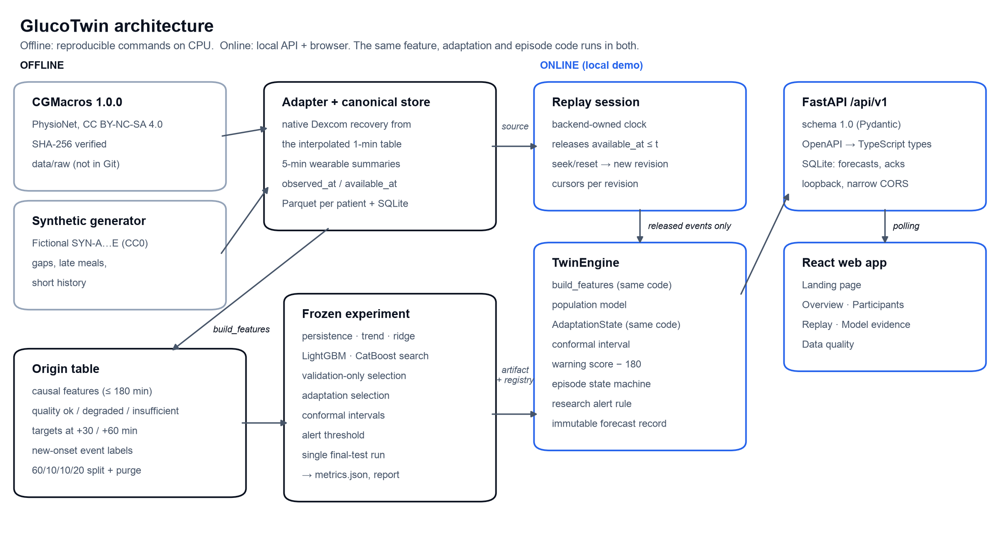

Narrative: [`docs/architecture.md`](docs/architecture.md) · contracts: [`docs/contracts.md`](docs/contracts.md) ·
replay semantics: [`docs/replay.md`](docs/replay.md).

## 11. Presentation

**[`docs/submission/GlucoTwin_Presentation.pdf`](docs/submission/GlucoTwin_Presentation.pdf)** ·
editable [`GlucoTwin_Presentation.pptx`](docs/submission/GlucoTwin_Presentation.pptx) — problem, use case, data,
architecture, models, measured outcomes, limitations and next steps. Every number is generated from the experiment
artifact by [`scripts/build_submission_assets.py`](scripts/build_submission_assets.py).

## 12. Accessible files and links

All submission links above are relative paths to files tracked in this repository; none points to a private drive,
authenticated notebook or local-only file. Last local check: **20 October 2026** — every README link target and every link in the team folder index exists, is
tracked by Git and opens (PDF pages and PPTX slides counted). **Not yet verified:** public repository visibility,
signed-out access and the YouTube link, because the repository has not been published and the video has not been
uploaded. Results per link: [`docs/submission_access_audit.md`](docs/submission_access_audit.md).

**[Judge guide (5 minutes)](docs/judge_guide.md)**: each part of the brief, how to verify it and what we do not claim.

---

## Run it locally

### Synthetic demonstration (no download, ~3 minutes)

Requirements: [uv](https://docs.astral.sh/uv/) and Node.js 24 (as in CI; 22.22 or later also works). The frontend tests need it: vitest 5 and jsdom 30 do not run on Node 20.

```bash
make setup        # Python + web dependencies
make synthetic    # fictional fixtures + synthetic demonstration model
make dev          # API on http://127.0.0.1:8000 and web app on http://127.0.0.1:5173
```

Open http://127.0.0.1:5173 (landing page) → **Open workspace** → **New replay** → *Synthetic demonstration*. Synthetic participants exercise edge cases
(sensor gaps, late meal logs, short history). Nothing computed on them is clinical evidence.

### Recorded-data replay — CGMacros 1.0.0

The dataset (CC BY-NC-SA 4.0, ≈ 657 MB) is **not** included. Download it yourself and reproduce everything:

```bash
make data-download   # PhysioNet open-data mirror; verifies SHA256SUMS.txt (`uv run glucotwin data download --primary` uses physionet.org)
make data            # verify + normalize + split manifest + reports/data_audit.md   (idempotent)
make experiment      # v2, then the fusion-constrained protocol: search, selection, adaptation, calibration, test run;
                     # the second run registers the serving model (~2 min each on a laptop CPU)
make dev
```

If you already have the files, place them in `data/raw/cgmacros/1.0.0/` and run `make data`. A changed or partial file
fails verification. The published 1-minute CGM columns are linearly interpolated; the adapter recovers the native
5-minute Dexcom readings and never treats interpolated rows as measurements ([`docs/data_card.md`](docs/data_card.md)).

### Larger-data research experiment (optional)

Prerequisites: the CGMacros steps above (`make data-download`, `make data`, `make experiment` — the v2 recipe is the
comparator).

```bash
make data-shanghai   # ShanghaiT2DM (3.7 MB, CC BY 4.0): download, verify publisher MD5, import
make manifest        # canonical CGMacros export + reports/dataset_expansion_audit.md
make research        # freeze → nested development → outer assessment → external → reports (~15 min on 10 CPU cores)
```

Exact numbers: fold membership and training-row order of `gt-nested-2026-10-12-v1` follow this installation's salted
pseudonyms, so another installation gets an equally valid but different draw; the declared successor protocol assigns
folds and orders rows by public source keys so every installation reproduces the same split. With the same salt, a
clean copy reproduced every headline number and the internal predictions bit for bit
([verification](reports/verification.md)).

The research runner writes only `artifacts/research/` and never the model registry; a frozen candidate reaches the app
only through `uv run glucotwin research promote --track multimodal_5min --yes` (rollback to the current demo model:
`uv run glucotwin research rollback --to lightgbm.dyn-prof-v2.gt-primary-2026-10-13-fusion`). An assessment that was already
opened refuses to run again without `--reopen-reason`. AI-READI needs steps only you can complete; they are listed in
[`reports/dataset_expansion_audit.md`](reports/dataset_expansion_audit.md).

### Replay semantics in one paragraph

The backend owns each session's clock. Only records whose observation **and** availability times are at or before the
clock are released; forecasts are stored immutably; seeking or resetting creates a new session revision, rebuilds the
twin from earlier data only and invalidates old cursors. Replay times are shown as “Day N · HH:MM” on a declared
synthetic UTC timeline ([`docs/replay.md`](docs/replay.md)).

## Verification

```bash
make test       # backend tests: leakage, labels, splits, adaptation maturity, activity windows, warning matching, replay invariants, API, integration
make test-web   # type check + frontend tests + production build
make e2e        # Playwright journeys on their own API + web server with throwaway storage (also refreshes reports/ui/*.png)
make demo-gif   # re-records the README GIF (reports/ui/demo-recorded-warning.gif) from the same throwaway servers; needs ffmpeg
uv run python scripts/demo_sequence.py     # re-records the demo replay sequence from the API
uv run python scripts/check_submission.py  # README links, anchors, tracked files, PDF/PPTX readability
scripts/clean_copy_check.sh /tmp/gt-clean  # Git-publishable files only, in an empty directory: setup, tests, e2e, Shanghai path
```

Latest results: [`reports/verification.md`](reports/verification.md) · integration audit:
[`reports/integration_audit.md`](reports/integration_audit.md).

## Repository layout

```text
.
├── Kryptonite_VESIT/         team folder (Team Name_College Name): index of the submission files
├── apps/web/                 React clinician workspace
│   ├── src/                  pages, twin components, API client, state
│   └── e2e/                  Playwright journeys (also produce reports/ui/*.png)
├── services/api/             FastAPI service: catalogue, replay sessions, SQLite audit, contracts export
├── packages/contracts/       OpenAPI, validated example payloads, generated TypeScript types
├── ml/glucotwin/             the Python package
│   ├── data/                 dataset adapters (CGMacros, ShanghaiT2DM, AI-READI access), canonical store, inventory
│   ├── models/               baselines, LightGBM/CatBoost population models, patient adaptation
│   ├── evaluation/           primary experiment runner, metrics, warnings, reports
│   ├── research/             nested participant benchmark and external evaluation
│   └── features.py, twin.py  feature builder (offline = online) and the replay twin engine
├── configs/
│   ├── data.yaml             availability and data policies
│   ├── sources.yaml          dataset source registry (URLs, checksums, licences)
│   ├── experiment.yaml       v2 protocol (gt-primary-2026-10-11-v2), the base of the serving protocol
│   ├── experiments/          v1; fusion-constrained gt-primary-2026-10-13-fusion (serving model); nested v1/v2; two-hour gt-2h-*
│   └── submission.yaml       team, links and video metadata for the submission assets
├── docs/                     product, system, model/data and submission documents — index: docs/README.md
│   └── submission/           presentation (PDF, PPTX) and architecture diagram (PDF)
├── reports/                  generated reports, figures and UI screenshots (+ archived v1 and v2 reports)
├── scripts/                  submission assets, demo-sequence recorder, landing preview, submission link check
├── tests/                    backend tests (leakage, splits, adaptation, warnings, replay, API, research)
├── artifacts/                models, experiment outputs, registry            (git-ignored; README kept)
├── data/                     raw and processed datasets, synthetic fixtures   (git-ignored)
└── var/                      local replay database and logs                  (git-ignored)
```

## Documentation index

Grouped index with one line per document: **[`docs/README.md`](docs/README.md)**.

* **Model and data:** [Model card](docs/model_card.md) · [Data card](docs/data_card.md) ·
  [Feature availability](docs/feature_availability.md) · [Data schema](docs/data_schema.md) ·
  [Decisions](docs/decisions.md) · [Next experiment](docs/next_experiment.md)
* **System:** [Product](docs/product.md) · [Architecture](docs/architecture.md) · [Replay](docs/replay.md) ·
  [Contracts](docs/contracts.md) · [Frontend handoff](docs/frontend-handoff.md) ·
  [Artifact manifest](docs/artifact_manifest.md)
* **Evidence:** [Evaluation report](reports/evaluation_report.md) · [Repair report](reports/repair_report.md) ·
  [Nested benchmark report](reports/nested_benchmark_report.md) · [Model upgrade review](reports/model_upgrade_review.md) ·
  [Dataset expansion audit](reports/dataset_expansion_audit.md) · [Verification](reports/verification.md) ·
  [Integration audit](reports/integration_audit.md) · [Two-hour benchmark](reports/two_hour_benchmark.md) ·
  [Two hours ahead, external](reports/two_hour_external.md) · [Two-hour classifier (negative)](reports/two_hour_classifier.md) ·
  [Time in warning](reports/warning_time_share.md) · [Cold-start profile](reports/cold_start_profile.md) ·
  [Judge guide](docs/judge_guide.md) · [Screenshots](reports/ui/README.md)
* **Submission:** [Checklist](docs/submission_checklist.md) · [Access audit](docs/submission_access_audit.md) ·
  [Team details](docs/team_details.md) · [Demo script](docs/demo_script.md) ·
  [Presentation outline](docs/presentation_outline.md) · [Jury questions](docs/jury_questions.md)
