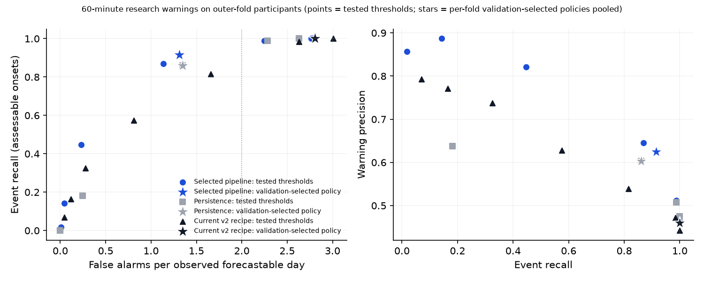
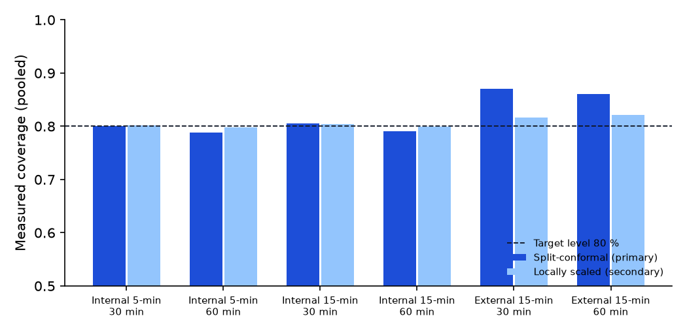

# Nested benchmark report — `gt-nested-2026-10-12-v1`

Generated by `glucotwin research report` from saved predictions on 2026-10-12. Protocol declared 2026-10-12, split membership frozen 2026-10-12T13:28:51+00:00 (protocol hash `7ef1a58ff9ec1807`, split hash `e3695ca98334797c`). Outer assessment opened 2026-10-12T13:42:38+00:00.

> **Scope.** Internal nested participant-level evaluation of CGMacros (14 people already inspected in v1/v2: internal validation, not untouched evidence). The serving model was not changed by this experiment.

## Inspection history

* 2026-10-11: CGMacros Type 2 cohort (14 people): v1 final-test segment (last 20 % of each recording) inspected for every v1 candidate; v2 corrected re-run inspected on the same segment. Validation segments used for v1/v2 selection. The v2 serving recipe (LightGBM dyn-v2 hyperparameters, adaptation k=96/half-life 240, warning margin -30) was chosen on these 14 people. Nested resampling of CGMacros is therefore internal validation, not untouched evidence.
* 2026-10-12: ShanghaiT2DM schema and quality inspection only: archive layout, column headers, units (all CGM values are multiples of 1.8), cadence steps, missing cells, participant/recording counts and the 72 observed-hour eligibility count (98/100). No forecast, error, event or glucose-outcome summary was computed.
* 2026-10-12: Development-only smoke run (`glucotwin research smoke`) on one inner split of outer fold 1 to measure fit times before the measured search. No outer-assessment or external participant was loaded.

## Folds

| Fold | Assessment | Calibration | Development | Inner folds |
|---|---:|---:|---:|---|
| outer-1 | 3 | 2 | 9 | 3/3/3 |
| outer-2 | 3 | 2 | 9 | 3/3/3 |
| outer-3 | 3 | 2 | 9 | 3/3/3 |
| outer-4 | 3 | 2 | 9 | 3/3/3 |
| outer-5 | 2 | 2 | 10 | 4/3/3 |
| final | 0 | 2 | 12 | 4/4/4 |

## 5-minute multimodal track (CGMacros)

### Selection on inner out-of-fold predictions

| Fold | Selected | Personalization | Rationale |
|---|---|---|---|
| outer-1 | `ridge:cgm-only-v1` | v2_policy (k=96, half-life 240 min) | ridge:cgm-only-v1 inner-OOF score 19.292 mg/dL (best 18.882); 3 candidate(s) within the 0.5 mg/dL margin; complexity order then smaller feature set. |
| outer-2 | `lightgbm_l1:cgm-only-v1` | v2_policy (k=96, half-life 240 min) | lightgbm_l1:cgm-only-v1 inner-OOF score 17.757 mg/dL (best 17.757); 3 candidate(s) within the 0.5 mg/dL margin; complexity order then smaller feature set. |
| outer-3 | `ridge:cgm-only-v1` | v2_policy (k=96, half-life 240 min) | ridge:cgm-only-v1 inner-OOF score 18.513 mg/dL (best 18.442); 4 candidate(s) within the 0.5 mg/dL margin; complexity order then smaller feature set. |
| outer-4 | `ridge:cgm-only-v1` | v2_policy (k=96, half-life 240 min) | ridge:cgm-only-v1 inner-OOF score 18.699 mg/dL (best 18.368); 5 candidate(s) within the 0.5 mg/dL margin; complexity order then smaller feature set. |
| outer-5 | `ridge:cgm-only-v1` | v2_policy (k=96, half-life 240 min) | ridge:cgm-only-v1 inner-OOF score 18.921 mg/dL (best 18.636); 5 candidate(s) within the 0.5 mg/dL margin; complexity order then smaller feature set. |
| final | `ridge:cgm-only-v1` | v2_policy (k=96, half-life 240 min) | ridge:cgm-only-v1 inner-OOF score 18.305 mg/dL (best 17.944); 5 candidate(s) within the 0.5 mg/dL margin; complexity order then smaller feature set. |

### Outer-fold results (14 participants, each assessed once)

Macro over participants (each person weighted equally), mg/dL. High-glucose MAE uses origins whose target exceeded 180 mg/dL (people with at least 20 such origins). Availability = share of target-bearing origins that received a forecast.

| Pipeline | MAE 30 | MAE 60 | RMSE 30 | RMSE 60 | High-glucose MAE 60 | Availability | People |
|---|---:|---:|---:|---:|---:|---:|---:|
| Selected by the declared rule (per fold) — selected personalization | 13.88 | 22.30 | 20.71 | 32.40 | 39.71 | 99.55 % | 14 |
| Selected by the declared rule (per fold) — population only | 14.11 | 22.78 | 20.81 | 32.69 | 39.35 | 99.55 % | 14 |
| Persistence — population only | 15.34 | 24.47 | 23.14 | 36.15 | 45.03 | 99.55 % | 14 |
| Linear trend — population only | 14.66 | 24.71 | 22.05 | 36.46 | 44.63 | 99.55 % | 14 |
| Ridge, cgm-only-v1 — population only | 14.09 | 22.69 | 20.71 | 32.39 | 38.60 | 99.55 % | 14 |
| LightGBM (L2 objective, L2 stopping), cgm-only-v1 — population only | 14.25 | 22.84 | 21.00 | 32.77 | 39.51 | 99.55 % | 14 |
| LightGBM (L1 objective, macro-MAE stopping), cgm-only-v1 — population only | 13.99 | 22.40 | 21.11 | 33.12 | 42.46 | 99.55 % | 14 |
| CatBoost (RMSE), cgm-only-v1 — population only | 14.17 | 22.81 | 20.93 | 32.73 | 39.62 | 99.55 % | 14 |
| Ridge, dyn-v2 — population only | 14.40 | 23.39 | 20.82 | 32.73 | 37.88 | 99.55 % | 14 |
| LightGBM (L2 objective, L2 stopping), dyn-v2 — population only | 14.85 | 25.27 | 21.25 | 34.24 | 37.61 | 99.55 % | 14 |
| LightGBM (L1 objective, macro-MAE stopping), dyn-v2 — population only | 14.46 | 23.55 | 21.24 | 33.73 | 41.49 | 99.55 % | 14 |
| CatBoost (RMSE), dyn-v2 — population only | 15.25 | 25.34 | 21.64 | 34.50 | 37.25 | 99.55 % | 14 |
| Ridge, dyn-prof-v2 — population only | 16.61 | 28.88 | 22.27 | 36.63 | 35.67 | 99.55 % | 14 |
| LightGBM (L2 objective, L2 stopping), dyn-prof-v2 — population only | 15.19 | 24.52 | 21.48 | 33.69 | 38.70 | 99.55 % | 14 |
| LightGBM (L1 objective, macro-MAE stopping), dyn-prof-v2 — population only | 14.43 | 23.50 | 21.25 | 33.73 | 43.07 | 99.55 % | 14 |
| CatBoost (RMSE), dyn-prof-v2 — population only | 14.97 | 24.55 | 21.32 | 33.66 | 38.09 | 99.55 % | 14 |
| Best LightGBM (L2 objective, L2 stopping) (per fold) — selected personalization | 14.18 | 22.75 | 20.90 | 32.56 | 39.71 | 99.55 % | 14 |
| Best LightGBM (L1 objective, macro-MAE stopping) (per fold) — selected personalization | 13.89 | 22.32 | 20.99 | 32.92 | 41.66 | 99.55 % | 14 |
| Best CatBoost (RMSE) (per fold) — selected personalization | 13.99 | 22.47 | 20.84 | 32.51 | 40.19 | 99.55 % | 14 |
| Current v2 serving recipe (refit per fold), dyn-v2 — v2 adaptation policy | 14.52 | 24.25 | 21.04 | 33.60 | 37.00 | 99.55 % | 14 |
| Current v2 serving recipe (refit per fold), dyn-v2 — population only | 15.42 | 26.82 | 21.71 | 35.78 | 36.60 | 99.55 % | 14 |

### Paired comparisons (participant-cluster bootstrap, 2,000 resamples)

| Comparison (a minus b, mg/dL) | Horizon | Mean difference | 95 % CI | Improved / worsened |
|---|---:|---:|---|---|
| Selected pipeline minus persistence | 30 | -1.46 | [-1.90, -1.02] | 13 / 1 of 14 |
| Selected pipeline minus persistence | 60 | -2.16 | [-2.92, -1.38] | 13 / 1 of 14 |
| Selected pipeline: personalization minus population only | 30 | -0.22 | [-0.42, -0.06] | 11 / 3 of 14 |
| Selected pipeline: personalization minus population only | 60 | -0.47 | [-0.94, -0.10] | 11 / 3 of 14 |
| Selected pipeline: best grid adaptation minus v2 policy | 30 | -0.09 | [-0.20, +0.00] | 9 / 5 of 14 |
| Selected pipeline: best grid adaptation minus v2 policy | 60 | -0.28 | [-0.56, -0.05] | 11 / 3 of 14 |
| Selected pipeline minus current v2 recipe | 30 | -0.64 | [-0.98, -0.32] | 12 / 2 of 14 |
| Selected pipeline minus current v2 recipe | 60 | -1.95 | [-2.83, -1.04] | 13 / 1 of 14 |
| High-glucose error (target > 180): selected minus current v2 recipe | 30 | +0.66 | [-0.19, +1.77] | 3 / 11 of 14 |
| High-glucose error (target > 180): selected minus current v2 recipe | 60 | +2.71 | [+0.28, +5.11] | 4 / 10 of 14 |
| Activity inputs: LightGBM L2 dyn-v2 minus CGM-only | 30 | +0.61 | [+0.18, +1.09] | 4 / 10 of 14 |
| Activity inputs: LightGBM L2 dyn-v2 minus CGM-only | 60 | +2.42 | [+1.21, +3.86] | 1 / 13 of 14 |
| Profile inputs: LightGBM L2 dyn-prof-v2 minus dyn-v2 | 30 | +0.34 | [-0.28, +0.89] | 4 / 10 of 14 |
| Profile inputs: LightGBM L2 dyn-prof-v2 minus dyn-v2 | 60 | -0.75 | [-2.19, +0.61] | 7 / 7 of 14 |
| L1 objective + macro-MAE stopping minus L2 (cgm-only-v1, population) | 30 | -0.26 | [-0.50, -0.01] | 10 / 4 of 14 |
| L1 objective + macro-MAE stopping minus L2 (cgm-only-v1, population) | 60 | -0.44 | [-1.11, +0.19] | 9 / 5 of 14 |
| CatBoost minus LightGBM L2 (cgm-only-v1, population) | 30 | -0.08 | [-0.17, +0.00] | 9 / 5 of 14 |
| CatBoost minus LightGBM L2 (cgm-only-v1, population) | 60 | -0.04 | [-0.19, +0.09] | 6 / 8 of 14 |
| L1 objective + macro-MAE stopping minus L2 (dyn-v2, population) | 30 | -0.40 | [-0.76, -0.08] | 10 / 4 of 14 |
| L1 objective + macro-MAE stopping minus L2 (dyn-v2, population) | 60 | -1.72 | [-2.92, -0.68] | 12 / 2 of 14 |
| CatBoost minus LightGBM L2 (dyn-v2, population) | 30 | +0.39 | [-0.08, +0.92] | 5 / 9 of 14 |
| CatBoost minus LightGBM L2 (dyn-v2, population) | 60 | +0.07 | [-0.67, +0.82] | 6 / 8 of 14 |
| L1 objective + macro-MAE stopping minus L2 (dyn-prof-v2, population) | 30 | -0.76 | [-1.21, -0.33] | 11 / 3 of 14 |
| L1 objective + macro-MAE stopping minus L2 (dyn-prof-v2, population) | 60 | -1.02 | [-1.98, -0.17] | 11 / 3 of 14 |
| CatBoost minus LightGBM L2 (dyn-prof-v2, population) | 30 | -0.22 | [-0.48, +0.03] | 7 / 7 of 14 |
| CatBoost minus LightGBM L2 (dyn-prof-v2, population) | 60 | +0.03 | [-0.89, +0.79] | 6 / 8 of 14 |
| Best CatBoost minus best LightGBM L2 (each with its selected personalization) | 30 | -0.19 | [-0.38, -0.04] | 10 / 4 of 14 |
| Best CatBoost minus best LightGBM L2 (each with its selected personalization) | 60 | -0.27 | [-0.71, +0.05] | 10 / 4 of 14 |
| Best LightGBM L1 minus best LightGBM L2 (each with its selected personalization) | 30 | -0.29 | [-0.52, -0.03] | 11 / 3 of 14 |
| Best LightGBM L1 minus best LightGBM L2 (each with its selected personalization) | 60 | -0.42 | [-1.00, +0.15] | 9 / 5 of 14 |

### Cold start and personalization (selected pipeline)

Elapsed history = time since the first reading of the current recording.

| Mode | Horizon | First 6 h | 6–24 h | After 24 h |
|---|---:|---:|---:|---:|
| population only | 30 | 17.57 (n=840, 14 people) | 15.69 (n=3,015, 14 people) | 13.89 (n=35,791, 14 people) |
| population only | 60 | 24.78 (n=840, 14 people) | 24.17 (n=3,015, 14 people) | 22.61 (n=35,698, 14 people) |
| v2 adaptation policy | 30 | 17.68 (n=840, 14 people) | 15.49 (n=3,015, 14 people) | 13.66 (n=35,791, 14 people) |
| v2 adaptation policy | 60 | 25.04 (n=840, 14 people) | 23.84 (n=3,015, 14 people) | 22.11 (n=35,698, 14 people) |
| best grid adaptation | 30 | 17.75 (n=840, 14 people) | 15.45 (n=3,015, 14 people) | 13.56 (n=35,791, 14 people) |
| best grid adaptation | 60 | 25.19 (n=840, 14 people) | 23.60 (n=3,015, 14 people) | 21.81 (n=35,698, 14 people) |
| adaptation frozen after 24 h | 30 | 17.68 (n=840, 14 people) | 15.49 (n=3,015, 14 people) | 13.95 (n=35,791, 14 people) |
| adaptation frozen after 24 h | 60 | 25.04 (n=840, 14 people) | 23.84 (n=3,015, 14 people) | 22.83 (n=35,698, 14 people) |
| selected personalization | 30 | 17.68 (n=840, 14 people) | 15.49 (n=3,015, 14 people) | 13.66 (n=35,791, 14 people) |
| selected personalization | 60 | 25.04 (n=840, 14 people) | 23.84 (n=3,015, 14 people) | 22.11 (n=35,698, 14 people) |

### Prediction ranges (target level 80 %)

| Pipeline | Horizon | Method | Coverage (pooled) | Coverage (macro) | Participant range | Mean width | Interval score | Low / usual / high glucose coverage | No interval |
|---|---:|---|---:|---:|---|---:|---:|---|---:|
| Selected — selected personalization | 30 | split-conformal | 80.07 % | 80.07 % | 67.90 %–89.53 % | 43.4 | 77.5 | — / 84.88 % / 70.00 % | 0 |
| Selected — selected personalization | 30 | locally scaled (fallback 0.42 %) | 80.14 % | 80.14 % | 76.70 %–83.58 % | 42.3 | 76.7 | — / 83.62 % / 72.86 % | 0 |
| Selected — selected personalization | 60 | split-conformal | 78.81 % | 78.81 % | 69.48 %–90.25 % | 66.7 | 122.4 | — / 83.66 % / 68.56 % | 0 |
| Selected — selected personalization | 60 | locally scaled (fallback 0.64 %) | 79.79 % | 79.79 % | 76.82 %–83.44 % | 67.1 | 121.9 | — / 83.16 % / 72.67 % | 0 |

### Research warnings (60-minute horizon, outer folds)

Thresholds were chosen per fold on inner out-of-fold predictions of the exact final pipeline. False alarms per observed forecastable day use non-overlapping, gap-respecting exposure.

| Pipeline | Policy | Thresholds by fold | Recall (95 % CI) | Missed / onsets | Precision | False alarms per observed day (95 % CI) | per eligible day | Warnings per observed day | Censored | Qualified lead median (IQR) |
|---|---|---|---|---|---:|---|---:|---:|---:|---|
| Persistence — population only | workload ≤ 2.0/day (primary) | -10, -10, -10, -10, -10 | 0.860 [0.81, 0.90] | 46 / 329 | 0.603 | 1.35 [1.12, 1.59] | 2.07 | 3.41 | 2 | 10.0 (5.0–25.0) |
| Persistence — population only | max F1 (v1/v2 rule) | -10, -10, -10, -10, -10 | 0.860 [0.81, 0.90] | 46 / 329 | 0.603 | 1.35 [1.12, 1.59] | 2.07 | 3.41 | 2 | 10.0 (5.0–25.0) |
| Persistence — population only | budget 0.5/day | +0, +0, +0, +0, +0 | 0.182 [0.14, 0.23] | 269 / 329 | 0.638 | 0.25 [0.16, 0.33] | 0.38 | 0.69 | 1 | 5.0 (5.0–15.0) |
| Persistence — population only | budget 1.0/day | +0, +0, +0, +0, +0 | 0.182 [0.14, 0.23] | 269 / 329 | 0.638 | 0.25 [0.16, 0.33] | 0.38 | 0.69 | 1 | 5.0 (5.0–15.0) |
| Persistence — population only | budget 3.0/day | -30, -20, -30, -30, -30 | 0.994 [0.98, 1.00] | 2 / 329 | 0.484 | 2.53 [1.90, 3.14] | 3.88 | 4.92 | 3 | 30.0 (10.0–60.0) |
| Linear trend — population only | workload ≤ 2.0/day (primary) | +0, +0, +0, +0, +0 | 0.912 [0.88, 0.95] | 29 / 329 | 0.581 | 1.56 [1.23, 1.93] | 2.40 | 3.77 | 5 | 10.0 (5.0–25.0) |
| Linear trend — population only | max F1 (v1/v2 rule) | +0, +0, +0, +0, +0 | 0.912 [0.88, 0.95] | 29 / 329 | 0.581 | 1.56 [1.23, 1.93] | 2.40 | 3.77 | 5 | 10.0 (5.0–25.0) |
| Linear trend — population only | budget 0.5/day | +20, +20, +20, +20, +20 | 0.344 [0.26, 0.43] | 216 / 329 | 0.758 | 0.26 [0.17, 0.35] | 0.40 | 1.09 | 2 | 5.0 (5.0–10.0) |
| Linear trend — population only | budget 1.0/day | +10, +10, +10, +10, +10 | 0.593 [0.50, 0.68] | 134 / 329 | 0.668 | 0.70 [0.53, 0.90] | 1.08 | 2.13 | 2 | 5.0 (5.0–15.0) |
| Linear trend — population only | budget 3.0/day | -10, -10, -10, -20, -20 | 0.994 [0.99, 1.00] | 2 / 329 | 0.467 | 2.71 [2.04, 3.56] | 4.15 | 5.12 | 5 | 20.0 (10.0–45.0) |
| Selected by the declared rule (per fold) — selected personalization | workload ≤ 2.0/day (primary) | +0, -10, +0, +0, +0 | 0.915 [0.88, 0.95] | 28 / 329 | 0.625 | 1.31 [1.00, 1.60] | 2.01 | 3.51 | 3 | 10.0 (5.0–25.0) |
| Selected by the declared rule (per fold) — selected personalization | max F1 (v1/v2 rule) | +0, -10, +0, +0, +0 | 0.915 [0.88, 0.95] | 28 / 329 | 0.625 | 1.31 [1.00, 1.60] | 2.01 | 3.51 | 3 | 10.0 (5.0–25.0) |
| Selected by the declared rule (per fold) — selected personalization | budget 0.5/day | +10, +10, +10, +10, +10 | 0.447 [0.38, 0.52] | 182 / 329 | 0.821 | 0.23 [0.15, 0.32] | 0.35 | 1.31 | 2 | 5.0 (5.0–10.0) |
| Selected by the declared rule (per fold) — selected personalization | budget 1.0/day | +10, +0, +10, +10, +10 | 0.523 [0.45, 0.60] | 157 / 329 | 0.785 | 0.34 [0.24, 0.45] | 0.52 | 1.60 | 2 | 5.0 (5.0–10.0) |
| Selected by the declared rule (per fold) — selected personalization | budget 3.0/day | -30, -20, -10, -10, -30 | 1.000 [1.00, 1.00] | 0 / 329 | 0.496 | 2.42 [1.81, 3.04] | 3.71 | 4.83 | 3 | 30.0 (10.0–60.0) |
| Best LightGBM (L2 objective, L2 stopping) (per fold) — selected personalization | workload ≤ 2.0/day (primary) | +0, +0, +0, -10, +0 | 0.839 [0.79, 0.89] | 53 / 329 | 0.591 | 1.38 [1.05, 1.70] | 2.12 | 3.43 | 6 | 10.0 (5.0–25.0) |
| Best LightGBM (L2 objective, L2 stopping) (per fold) — selected personalization | max F1 (v1/v2 rule) | +0, +0, +0, +0, +0 | 0.796 [0.75, 0.84] | 67 / 329 | 0.617 | 1.18 [0.88, 1.51] | 1.81 | 3.12 | 6 | 10.0 (5.0–20.0) |
| Best LightGBM (L2 objective, L2 stopping) (per fold) — selected personalization | budget 0.5/day | +10, +10, +10, +10, +10 | 0.465 [0.41, 0.52] | 176 / 329 | 0.769 | 0.33 [0.22, 0.46] | 0.51 | 1.46 | 2 | 5.0 (5.0–10.0) |
| Best LightGBM (L2 objective, L2 stopping) (per fold) — selected personalization | budget 1.0/day | +10, +0, +10, +10, +10 | 0.523 [0.44, 0.62] | 157 / 329 | 0.726 | 0.47 [0.30, 0.66] | 0.72 | 1.75 | 4 | 5.0 (5.0–15.0) |
| Best LightGBM (L2 objective, L2 stopping) (per fold) — selected personalization | budget 3.0/day | -30, -10, -10, -30, -30 | 0.994 [0.99, 1.00] | 2 / 329 | 0.463 | 2.75 [2.08, 3.40] | 4.22 | 5.14 | 3 | 35.0 (15.0–60.0) |
| Best LightGBM (L1 objective, macro-MAE stopping) (per fold) — selected personalization | workload ≤ 2.0/day (primary) | -10, -10, -10, -10, -10 | 0.957 [0.94, 0.98] | 14 / 329 | 0.577 | 1.67 [1.35, 2.03] | 2.57 | 3.98 | 4 | 10.0 (5.0–30.0) |
| Best LightGBM (L1 objective, macro-MAE stopping) (per fold) — selected personalization | max F1 (v1/v2 rule) | -10, -10, -10, -10, -10 | 0.957 [0.94, 0.98] | 14 / 329 | 0.577 | 1.67 [1.35, 2.03] | 2.57 | 3.98 | 4 | 10.0 (5.0–30.0) |
| Best LightGBM (L1 objective, macro-MAE stopping) (per fold) — selected personalization | budget 0.5/day | +10, +10, +0, +10, +10 | 0.416 [0.31, 0.53] | 192 / 329 | 0.741 | 0.35 [0.15, 0.62] | 0.53 | 1.35 | 2 | 5.0 (5.0–10.0) |
| Best LightGBM (L1 objective, macro-MAE stopping) (per fold) — selected personalization | budget 1.0/day | +0, +0, +0, +0, +0 | 0.650 [0.57, 0.73] | 115 / 329 | 0.690 | 0.69 [0.46, 0.98] | 1.07 | 2.26 | 2 | 5.0 (5.0–15.0) |
| Best LightGBM (L1 objective, macro-MAE stopping) (per fold) — selected personalization | budget 3.0/day | -30, -20, -20, -20, -20 | 0.997 [0.99, 1.00] | 1 / 329 | 0.482 | 2.55 [1.90, 3.29] | 3.91 | 4.96 | 4 | 25.0 (10.0–60.0) |
| Best CatBoost (RMSE) (per fold) — selected personalization | workload ≤ 2.0/day (primary) | -10, +0, +0, -10, +0 | 0.860 [0.81, 0.92] | 46 / 329 | 0.587 | 1.44 [1.11, 1.83] | 2.21 | 3.53 | 5 | 10.0 (5.0–27.5) |
| Best CatBoost (RMSE) (per fold) — selected personalization | max F1 (v1/v2 rule) | -10, +0, +0, +0, +0 | 0.821 [0.77, 0.88] | 59 / 329 | 0.605 | 1.27 [0.94, 1.70] | 1.96 | 3.27 | 5 | 10.0 (5.0–25.0) |
| Best CatBoost (RMSE) (per fold) — selected personalization | budget 0.5/day | +10, +10, +10, +10, +10 | 0.410 [0.35, 0.47] | 194 / 329 | 0.804 | 0.24 [0.15, 0.33] | 0.37 | 1.23 | 2 | 5.0 (5.0–10.0) |
| Best CatBoost (RMSE) (per fold) — selected personalization | budget 1.0/day | +10, +0, +10, +10, +10 | 0.474 [0.38, 0.59] | 173 / 329 | 0.761 | 0.35 [0.20, 0.52] | 0.54 | 1.51 | 3 | 5.0 (5.0–10.0) |
| Best CatBoost (RMSE) (per fold) — selected personalization | budget 3.0/day | -30, -10, -10, -20, -30 | 0.988 [0.98, 1.00] | 4 / 329 | 0.486 | 2.49 [1.87, 3.16] | 3.82 | 4.87 | 3 | 30.0 (10.0–60.0) |
| Current v2 serving recipe (refit per fold), dyn-v2 — v2 adaptation policy | workload ≤ 2.0/day (primary) | +0, +0, +0, +0, +0 | 0.815 [0.71, 0.90] | 61 / 329 | 0.539 | 1.66 [1.22, 2.17] | 2.54 | 3.63 | 4 | 15.0 (5.0–40.0) |
| Current v2 serving recipe (refit per fold), dyn-v2 — v2 adaptation policy | max F1 (v1/v2 rule) | -10, +0, +0, -30, -10 | 0.881 [0.76, 0.98] | 39 / 329 | 0.457 | 2.49 [1.75, 3.20] | 3.82 | 4.63 | 5 | 25.0 (10.0–55.0) |
| Current v2 serving recipe (refit per fold), dyn-v2 — v2 adaptation policy | budget 0.5/day | +30, +20, +20, +30, +20 | 0.255 [0.16, 0.37] | 245 / 329 | 0.718 | 0.24 [0.17, 0.31] | 0.37 | 0.86 | 2 | 5.0 (5.0–15.0) |
| Current v2 serving recipe (refit per fold), dyn-v2 — v2 adaptation policy | budget 1.0/day | +20, +10, +10, +10, +10 | 0.523 [0.38, 0.66] | 157 / 329 | 0.635 | 0.72 [0.46, 0.99] | 1.10 | 1.99 | 3 | 10.0 (5.0–25.0) |
| Current v2 serving recipe (refit per fold), dyn-v2 — v2 adaptation policy | budget 3.0/day | -30, -10, -10, -30, -30 | 0.988 [0.98, 1.00] | 4 / 329 | 0.458 | 2.79 [2.14, 3.38] | 4.28 | 5.18 | 5 | 40.0 (15.0–60.0) |
| Current v2 serving recipe (refit per fold), dyn-v2 — v2 adaptation policy | v2 margin −30 | -30, -30, -30, -30, -30 | 1.000 [1.00, 1.00] | 0 / 329 | 0.460 | 2.80 [2.07, 3.49] | 4.30 | 5.21 | 3 | 55.0 (25.0–60.0) |

30-minute horizon:

| Pipeline | Policy | Thresholds by fold | Recall (95 % CI) | Missed / onsets | Precision | False alarms per observed day (95 % CI) | per eligible day | Warnings per observed day | Censored | Qualified lead median (IQR) |
|---|---|---|---|---|---:|---|---:|---:|---:|---|
| Persistence — population only | workload ≤ 2.0/day (primary) | -10, -10, -10, -10, -10 | 0.848 [0.80, 0.89] | 50 / 329 | 0.595 | 1.38 [1.15, 1.62] | 2.10 | 3.41 | 2 | 10.0 (5.0–20.0) |
| Persistence — population only | max F1 (v1/v2 rule) | -10, -10, -10, -10, -10 | 0.848 [0.80, 0.89] | 50 / 329 | 0.595 | 1.38 [1.15, 1.62] | 2.10 | 3.41 | 2 | 10.0 (5.0–20.0) |
| Persistence — population only | budget 0.5/day | +0, +0, +0, +0, +0 | 0.164 [0.12, 0.21] | 275 / 329 | 0.575 | 0.29 [0.19, 0.39] | 0.44 | 0.69 | 1 | 5.0 (5.0–5.0) |
| Persistence — population only | budget 1.0/day | +0, +0, +0, +0, +0 | 0.164 [0.12, 0.21] | 275 / 329 | 0.575 | 0.29 [0.19, 0.39] | 0.44 | 0.69 | 1 | 5.0 (5.0–5.0) |
| Persistence — population only | budget 3.0/day | -30, -20, -30, -30, -30 | 0.994 [0.98, 1.00] | 2 / 329 | 0.484 | 2.53 [1.91, 3.17] | 3.87 | 4.92 | 3 | 25.0 (10.0–30.0) |
| Linear trend — population only | workload ≤ 2.0/day (primary) | -10, -10, -10, -10, -10 | 0.976 [0.96, 0.99] | 8 / 329 | 0.571 | 1.75 [1.40, 2.15] | 2.67 | 4.09 | 3 | 10.0 (5.0–20.0) |
| Linear trend — population only | max F1 (v1/v2 rule) | -10, -10, -10, -10, -10 | 0.976 [0.96, 0.99] | 8 / 329 | 0.571 | 1.75 [1.40, 2.15] | 2.67 | 4.09 | 3 | 10.0 (5.0–20.0) |
| Linear trend — population only | budget 0.5/day | +10, +10, +10, +10, +10 | 0.222 [0.15, 0.30] | 256 / 329 | 0.785 | 0.14 [0.07, 0.23] | 0.22 | 0.69 | 2 | 5.0 (5.0–5.0) |
| Linear trend — population only | budget 1.0/day | +10, +10, +0, +10, +10 | 0.395 [0.27, 0.52] | 199 / 329 | 0.707 | 0.39 [0.14, 0.70] | 0.60 | 1.35 | 2 | 5.0 (5.0–5.0) |
| Linear trend — population only | budget 3.0/day | -20, -10, -20, -20, -20 | 0.991 [0.97, 1.00] | 3 / 329 | 0.489 | 2.47 [1.76, 3.32] | 3.78 | 4.85 | 3 | 15.0 (10.0–30.0) |
| Selected by the declared rule (per fold) — selected personalization | workload ≤ 2.0/day (primary) | +0, -10, +0, +0, +0 | 0.887 [0.85, 0.93] | 37 / 329 | 0.632 | 1.23 [0.96, 1.52] | 1.88 | 3.37 | 3 | 5.0 (5.0–15.0) |
| Selected by the declared rule (per fold) — selected personalization | max F1 (v1/v2 rule) | +0, -10, +0, +0, +0 | 0.887 [0.85, 0.93] | 37 / 329 | 0.632 | 1.23 [0.96, 1.52] | 1.88 | 3.37 | 3 | 5.0 (5.0–15.0) |
| Selected by the declared rule (per fold) — selected personalization | budget 0.5/day | +10, +10, +10, +10, +10 | 0.374 [0.30, 0.47] | 206 / 329 | 0.774 | 0.26 [0.16, 0.38] | 0.40 | 1.17 | 2 | 5.0 (5.0–5.0) |
| Selected by the declared rule (per fold) — selected personalization | budget 1.0/day | +10, +0, +10, +10, +10 | 0.444 [0.35, 0.55] | 183 / 329 | 0.741 | 0.37 [0.24, 0.49] | 0.56 | 1.44 | 2 | 5.0 (5.0–10.0) |
| Selected by the declared rule (per fold) — selected personalization | budget 3.0/day | -20, -20, -20, -20, -20 | 1.000 [1.00, 1.00] | 0 / 329 | 0.467 | 2.72 [1.96, 3.67] | 4.17 | 5.14 | 4 | 20.0 (10.0–30.0) |
| Best LightGBM (L2 objective, L2 stopping) (per fold) — selected personalization | workload ≤ 2.0/day (primary) | +0, +0, +0, -10, -10 | 0.827 [0.76, 0.90] | 57 / 329 | 0.558 | 1.56 [1.15, 1.99] | 2.38 | 3.55 | 3 | 10.0 (5.0–15.0) |
| Best LightGBM (L2 objective, L2 stopping) (per fold) — selected personalization | max F1 (v1/v2 rule) | -10, -10, -10, -10, -10 | 0.976 [0.96, 0.99] | 8 / 329 | 0.531 | 2.05 [1.65, 2.52] | 3.13 | 4.40 | 3 | 10.0 (5.0–25.0) |
| Best LightGBM (L2 objective, L2 stopping) (per fold) — selected personalization | budget 0.5/day | +10, +10, +10, +10, +10 | 0.401 [0.34, 0.48] | 197 / 329 | 0.754 | 0.31 [0.20, 0.43] | 0.48 | 1.28 | 2 | 5.0 (5.0–10.0) |
| Best LightGBM (L2 objective, L2 stopping) (per fold) — selected personalization | budget 1.0/day | +10, +0, +10, +10, +0 | 0.495 [0.39, 0.62] | 166 / 329 | 0.647 | 0.65 [0.41, 0.89] | 0.99 | 1.85 | 3 | 5.0 (5.0–10.0) |
| Best LightGBM (L2 objective, L2 stopping) (per fold) — selected personalization | budget 3.0/day | -20, -10, -10, -20, -20 | 0.988 [0.98, 1.00] | 4 / 329 | 0.474 | 2.61 [1.91, 3.44] | 3.99 | 4.98 | 3 | 15.0 (10.0–25.0) |
| Best LightGBM (L1 objective, macro-MAE stopping) (per fold) — selected personalization | workload ≤ 2.0/day (primary) | -10, -10, -10, -10, -10 | 0.951 [0.93, 0.97] | 16 / 329 | 0.584 | 1.62 [1.30, 1.98] | 2.47 | 3.90 | 3 | 10.0 (5.0–20.0) |
| Best LightGBM (L1 objective, macro-MAE stopping) (per fold) — selected personalization | max F1 (v1/v2 rule) | -10, -10, -10, -10, -10 | 0.951 [0.93, 0.97] | 16 / 329 | 0.584 | 1.62 [1.30, 1.98] | 2.47 | 3.90 | 3 | 10.0 (5.0–20.0) |
| Best LightGBM (L1 objective, macro-MAE stopping) (per fold) — selected personalization | budget 0.5/day | +10, +10, +10, +10, +10 | 0.289 [0.20, 0.40] | 234 / 329 | 0.779 | 0.20 [0.12, 0.30] | 0.30 | 0.90 | 2 | 5.0 (5.0–10.0) |
| Best LightGBM (L1 objective, macro-MAE stopping) (per fold) — selected personalization | budget 1.0/day | +0, +0, +0, +0, +0 | 0.605 [0.52, 0.71] | 130 / 329 | 0.666 | 0.72 [0.51, 0.95] | 1.11 | 2.18 | 2 | 5.0 (5.0–10.0) |
| Best LightGBM (L1 objective, macro-MAE stopping) (per fold) — selected personalization | budget 3.0/day | -30, -20, -20, -20, -20 | 0.997 [0.99, 1.00] | 1 / 329 | 0.482 | 2.56 [1.88, 3.37] | 3.91 | 4.96 | 3 | 20.0 (10.0–30.0) |
| Best CatBoost (RMSE) (per fold) — selected personalization | workload ≤ 2.0/day (primary) | -10, +0, -10, -10, -10 | 0.936 [0.89, 0.97] | 21 / 329 | 0.561 | 1.75 [1.28, 2.29] | 2.67 | 3.99 | 2 | 10.0 (5.0–21.2) |
| Best CatBoost (RMSE) (per fold) — selected personalization | max F1 (v1/v2 rule) | -10, -10, -10, -10, -10 | 0.976 [0.96, 0.99] | 8 / 329 | 0.551 | 1.89 [1.46, 2.38] | 2.89 | 4.24 | 3 | 10.0 (5.0–25.0) |
| Best CatBoost (RMSE) (per fold) — selected personalization | budget 0.5/day | +10, +10, +10, +10, +10 | 0.344 [0.27, 0.42] | 216 / 329 | 0.774 | 0.24 [0.15, 0.34] | 0.37 | 1.07 | 2 | 5.0 (5.0–10.0) |
| Best CatBoost (RMSE) (per fold) — selected personalization | budget 1.0/day | +10, +0, +10, +10, +0 | 0.462 [0.33, 0.61] | 177 / 329 | 0.667 | 0.55 [0.31, 0.80] | 0.84 | 1.67 | 2 | 5.0 (5.0–10.0) |
| Best CatBoost (RMSE) (per fold) — selected personalization | budget 3.0/day | -20, -10, -10, -20, -20 | 0.988 [0.98, 1.00] | 4 / 329 | 0.484 | 2.51 [1.80, 3.40] | 3.84 | 4.89 | 3 | 15.0 (10.0–25.0) |
| Current v2 serving recipe (refit per fold), dyn-v2 — v2 adaptation policy | workload ≤ 2.0/day (primary) | +0, +0, +0, -10, +0 | 0.757 [0.63, 0.88] | 80 / 329 | 0.583 | 1.29 [0.96, 1.61] | 1.97 | 3.12 | 3 | 10.0 (5.0–20.0) |
| Current v2 serving recipe (refit per fold), dyn-v2 — v2 adaptation policy | max F1 (v1/v2 rule) | -10, -10, +0, -10, -10 | 0.851 [0.70, 0.98] | 49 / 329 | 0.499 | 2.04 [1.56, 2.54] | 3.11 | 4.09 | 4 | 10.0 (5.0–20.0) |
| Current v2 serving recipe (refit per fold), dyn-v2 — v2 adaptation policy | budget 0.5/day | +20, +10, +10, +20, +10 | 0.349 [0.23, 0.48] | 214 / 329 | 0.714 | 0.33 [0.20, 0.48] | 0.51 | 1.19 | 3 | 5.0 (5.0–10.0) |
| Current v2 serving recipe (refit per fold), dyn-v2 — v2 adaptation policy | budget 1.0/day | +10, +10, +10, +10, +0 | 0.480 [0.35, 0.62] | 171 / 329 | 0.653 | 0.61 [0.35, 0.93] | 0.93 | 1.77 | 3 | 5.0 (5.0–10.0) |
| Current v2 serving recipe (refit per fold), dyn-v2 — v2 adaptation policy | budget 3.0/day | -30, -10, -10, -20, -30 | 0.985 [0.97, 1.00] | 5 / 329 | 0.479 | 2.55 [1.97, 3.17] | 3.90 | 4.93 | 4 | 20.0 (10.0–30.0) |
| Current v2 serving recipe (refit per fold), dyn-v2 — v2 adaptation policy | v2 margin −30 | -30, -30, -30, -30, -30 | 1.000 [1.00, 1.00] | 0 / 329 | 0.453 | 2.88 [2.17, 3.56] | 4.40 | 5.30 | 5 | 30.0 (20.0–30.0) |

## 15-minute portable CGM-only track

### Selection on inner out-of-fold predictions

| Fold | Selected | Personalization | Rationale |
|---|---|---|---|
| outer-1 | `lightgbm_l1:cgm15-v1` | v2_policy (k=96, half-life 240 min) | lightgbm_l1:cgm15-v1 inner-OOF score 18.990 mg/dL (best 18.990); 1 candidate(s) within the 0.5 mg/dL margin; complexity order then smaller feature set. |
| outer-2 | `lightgbm_l1:cgm15-v1` | grid (k=48, half-life 720 min) | lightgbm_l1:cgm15-v1 inner-OOF score 17.673 mg/dL (best 17.673); 1 candidate(s) within the 0.5 mg/dL margin; complexity order then smaller feature set. |
| outer-3 | `lightgbm_l1:cgm15-v1` | v2_policy (k=96, half-life 240 min) | lightgbm_l1:cgm15-v1 inner-OOF score 18.237 mg/dL (best 18.237); 1 candidate(s) within the 0.5 mg/dL margin; complexity order then smaller feature set. |
| outer-4 | `ridge:cgm15-v1` | grid (k=24, half-life 720 min) | ridge:cgm15-v1 inner-OOF score 18.886 mg/dL (best 18.410); 4 candidate(s) within the 0.5 mg/dL margin; complexity order then smaller feature set. |
| outer-5 | `ridge:cgm15-v1` | grid (k=24, half-life 720 min) | ridge:cgm15-v1 inner-OOF score 19.211 mg/dL (best 18.753); 4 candidate(s) within the 0.5 mg/dL margin; complexity order then smaller feature set. |
| final | `lightgbm_l2:cgm15-v1` | v2_policy (k=96, half-life 240 min) | lightgbm_l2:cgm15-v1 inner-OOF score 18.297 mg/dL (best 17.996); 3 candidate(s) within the 0.5 mg/dL margin; complexity order then smaller feature set. |

### Outer-fold results (14 participants, each assessed once)

Macro over participants (each person weighted equally), mg/dL. High-glucose MAE uses origins whose target exceeded 180 mg/dL (people with at least 20 such origins). Availability = share of target-bearing origins that received a forecast.

| Pipeline | MAE 30 | MAE 60 | RMSE 30 | RMSE 60 | High-glucose MAE 60 | Availability | People |
|---|---:|---:|---:|---:|---:|---:|---:|
| Selected by the declared rule (per fold) — selected personalization | 14.06 | 22.21 | 21.13 | 32.62 | 41.23 | 99.53 % | 14 |
| Selected by the declared rule (per fold) — population only | 14.34 | 22.92 | 21.28 | 33.15 | 40.77 | 99.53 % | 14 |
| Persistence — population only | 15.35 | 24.47 | 23.16 | 36.15 | 45.12 | 99.53 % | 14 |
| Linear trend — population only | 14.90 | 24.59 | 22.56 | 36.28 | 45.22 | 99.53 % | 14 |
| Ridge, cgm15-v1 — population only | 14.46 | 23.00 | 21.24 | 32.78 | 39.05 | 99.53 % | 14 |
| LightGBM (L2 objective, L2 stopping), cgm15-v1 — population only | 14.32 | 22.92 | 21.09 | 32.91 | 39.86 | 99.53 % | 14 |
| LightGBM (L1 objective, macro-MAE stopping), cgm15-v1 — population only | 14.11 | 22.42 | 21.31 | 33.19 | 42.48 | 99.53 % | 14 |
| CatBoost (RMSE), cgm15-v1 — population only | 14.26 | 22.75 | 20.98 | 32.62 | 39.41 | 99.53 % | 14 |
| Best LightGBM (L2 objective, L2 stopping) (per fold) — selected personalization | 14.23 | 22.78 | 20.96 | 32.58 | 40.03 | 99.53 % | 14 |
| Best LightGBM (L1 objective, macro-MAE stopping) (per fold) — selected personalization | 14.04 | 22.23 | 21.19 | 32.80 | 41.76 | 99.53 % | 14 |
| Best CatBoost (RMSE) (per fold) — selected personalization | 14.13 | 22.49 | 20.84 | 32.23 | 39.59 | 99.53 % | 14 |

### Paired comparisons (participant-cluster bootstrap, 2,000 resamples)

| Comparison (a minus b, mg/dL) | Horizon | Mean difference | 95 % CI | Improved / worsened |
|---|---:|---:|---|---|
| Selected pipeline minus persistence | 30 | -1.29 | [-1.63, -0.98] | 14 / 0 of 14 |
| Selected pipeline minus persistence | 60 | -2.27 | [-2.71, -1.85] | 14 / 0 of 14 |
| Selected pipeline: personalization minus population only | 30 | -0.28 | [-0.60, -0.05] | 9 / 5 of 14 |
| Selected pipeline: personalization minus population only | 60 | -0.71 | [-1.53, -0.15] | 8 / 6 of 14 |
| Selected pipeline: best grid adaptation minus v2 policy | 30 | -0.20 | [-0.43, -0.05] | 11 / 3 of 14 |
| Selected pipeline: best grid adaptation minus v2 policy | 60 | -0.52 | [-1.13, -0.11] | 11 / 3 of 14 |
| L1 objective + macro-MAE stopping minus L2 (cgm15-v1, population) | 30 | -0.21 | [-0.44, +0.01] | 10 / 4 of 14 |
| L1 objective + macro-MAE stopping minus L2 (cgm15-v1, population) | 60 | -0.49 | [-0.99, +0.02] | 11 / 3 of 14 |
| CatBoost minus LightGBM L2 (cgm15-v1, population) | 30 | -0.06 | [-0.17, +0.05] | 7 / 7 of 14 |
| CatBoost minus LightGBM L2 (cgm15-v1, population) | 60 | -0.16 | [-0.38, +0.03] | 9 / 5 of 14 |
| Best CatBoost minus best LightGBM L2 (each with its selected personalization) | 30 | -0.10 | [-0.21, +0.01] | 10 / 4 of 14 |
| Best CatBoost minus best LightGBM L2 (each with its selected personalization) | 60 | -0.29 | [-0.58, -0.05] | 10 / 4 of 14 |
| Best LightGBM L1 minus best LightGBM L2 (each with its selected personalization) | 30 | -0.19 | [-0.34, -0.03] | 9 / 5 of 14 |
| Best LightGBM L1 minus best LightGBM L2 (each with its selected personalization) | 60 | -0.55 | [-0.93, -0.16] | 10 / 4 of 14 |

### Cold start and personalization (selected pipeline)

Elapsed history = time since the first reading of the current recording.

| Mode | Horizon | First 6 h | 6–24 h | After 24 h |
|---|---:|---:|---:|---:|
| population only | 30 | 17.97 (n=283, 14 people) | 15.87 (n=1,008, 14 people) | 14.12 (n=11,939, 14 people) |
| population only | 60 | 24.77 (n=283, 14 people) | 24.85 (n=1,008, 14 people) | 22.71 (n=11,909, 14 people) |
| v2 adaptation policy | 30 | 18.02 (n=283, 14 people) | 15.78 (n=1,008, 14 people) | 13.99 (n=11,939, 14 people) |
| v2 adaptation policy | 60 | 24.86 (n=283, 14 people) | 24.66 (n=1,008, 14 people) | 22.37 (n=11,909, 14 people) |
| best grid adaptation | 30 | 18.10 (n=283, 14 people) | 15.70 (n=1,008, 14 people) | 13.77 (n=11,939, 14 people) |
| best grid adaptation | 60 | 25.05 (n=283, 14 people) | 24.40 (n=1,008, 14 people) | 21.81 (n=11,909, 14 people) |
| adaptation frozen after 24 h | 30 | 18.10 (n=283, 14 people) | 15.71 (n=1,008, 14 people) | 13.92 (n=11,939, 14 people) |
| adaptation frozen after 24 h | 60 | 25.05 (n=283, 14 people) | 24.47 (n=1,008, 14 people) | 22.21 (n=11,909, 14 people) |
| selected personalization | 30 | 18.10 (n=283, 14 people) | 15.71 (n=1,008, 14 people) | 13.82 (n=11,939, 14 people) |
| selected personalization | 60 | 25.05 (n=283, 14 people) | 24.47 (n=1,008, 14 people) | 21.95 (n=11,909, 14 people) |

### Prediction ranges (target level 80 %)

| Pipeline | Horizon | Method | Coverage (pooled) | Coverage (macro) | Participant range | Mean width | Interval score | Low / usual / high glucose coverage | No interval |
|---|---:|---|---:|---:|---|---:|---:|---|---:|
| Selected — selected personalization | 30 | split-conformal | 80.57 % | 80.57 % | 68.82 %–89.01 % | 44.3 | 79.2 | — / 85.31 % / 70.72 % | 0 |
| Selected — selected personalization | 30 | locally scaled (fallback 0.85 %) | 80.37 % | 80.37 % | 77.27 %–83.40 % | 42.9 | 78.4 | — / 84.05 % / 72.74 % | 0 |
| Selected — selected personalization | 60 | split-conformal | 79.03 % | 79.03 % | 67.16 %–89.94 % | 67.5 | 124.3 | — / 83.70 % / 69.16 % | 0 |
| Selected — selected personalization | 60 | locally scaled (fallback 1.06 %) | 79.93 % | 79.93 % | 76.27 %–82.94 % | 67.5 | 123.4 | — / 83.33 % / 72.74 % | 0 |

## External assessment — ShanghaiT2DM

Opened once on 2026-10-12T13:43:15+00:00 with the frozen portable candidate `lightgbm_l2:cgm15-v1` (freeze hash `31b8872ba8a28293`), 98 participants. Regression and ranges only (no event metric is defined at 15-minute cadence).

| Pipeline | MAE 30 | MAE 60 | RMSE 30 | RMSE 60 | Availability | People |
|---|---:|---:|---:|---:|---:|---:|
| CatBoost (RMSE), cgm15-v1 — best grid adaptation | 10.89 | 19.25 | 15.15 | 26.48 | 99.61 % | 98 |
| CatBoost (RMSE), cgm15-v1 — selected personalization | 11.25 | 19.93 | 15.36 | 26.82 | 99.61 % | 98 |
| CatBoost (RMSE), cgm15-v1 — adaptation frozen after 24 h | 11.39 | 20.17 | 15.39 | 26.80 | 99.61 % | 98 |
| CatBoost (RMSE), cgm15-v1 — population only | 11.49 | 20.28 | 15.49 | 26.92 | 99.61 % | 98 |
| CatBoost (RMSE), cgm15-v1 — v2 adaptation policy | 11.25 | 19.93 | 15.36 | 26.82 | 99.61 % | 98 |
| LightGBM (L1 objective, macro-MAE stopping), cgm15-v1 — best grid adaptation | 10.81 | 19.00 | 15.17 | 26.33 | 99.61 % | 98 |
| LightGBM (L1 objective, macro-MAE stopping), cgm15-v1 — selected personalization | 10.85 | 19.11 | 15.22 | 26.48 | 99.61 % | 98 |
| LightGBM (L1 objective, macro-MAE stopping), cgm15-v1 — adaptation frozen after 24 h | 10.90 | 19.22 | 15.19 | 26.37 | 99.61 % | 98 |
| LightGBM (L1 objective, macro-MAE stopping), cgm15-v1 — population only | 10.94 | 19.26 | 15.26 | 26.52 | 99.61 % | 98 |
| LightGBM (L1 objective, macro-MAE stopping), cgm15-v1 — v2 adaptation policy | 10.85 | 19.11 | 15.22 | 26.48 | 99.61 % | 98 |
| LightGBM (L2 objective, L2 stopping), cgm15-v1 — best grid adaptation | 10.86 | 19.29 | 15.16 | 26.41 | 99.61 % | 98 |
| LightGBM (L2 objective, L2 stopping), cgm15-v1 — selected personalization **(candidate)** | 11.15 | 20.11 | 15.33 | 26.87 | 99.61 % | 98 |
| LightGBM (L2 objective, L2 stopping), cgm15-v1 — adaptation frozen after 24 h | 11.27 | 20.37 | 15.34 | 26.88 | 99.61 % | 98 |
| LightGBM (L2 objective, L2 stopping), cgm15-v1 — population only | 11.35 | 20.52 | 15.42 | 27.04 | 99.61 % | 98 |
| LightGBM (L2 objective, L2 stopping), cgm15-v1 — v2 adaptation policy | 11.15 | 20.11 | 15.33 | 26.87 | 99.61 % | 98 |
| Linear trend — population only | 11.29 | 20.44 | 16.27 | 29.04 | 99.61 % | 98 |
| Persistence — population only | 12.14 | 20.44 | 17.46 | 29.04 | 99.61 % | 98 |
| Ridge, cgm15-v1 — population only | 11.68 | 21.30 | 15.51 | 27.27 | 99.61 % | 98 |

| Comparison (a minus b, mg/dL) | Horizon | Mean difference | 95 % CI | Improved / worsened |
|---|---:|---:|---|---|
| Selected candidate minus persistence | 30 | -0.99 | [-1.21, -0.77] | 80 / 18 of 98 |
| Selected candidate minus persistence | 60 | -0.34 | [-0.76, +0.10] | 66 / 32 of 98 |
| Selected candidate minus linear trend | 30 | -0.14 | [-0.29, +0.02] | 68 / 30 of 98 |
| Selected candidate minus linear trend | 60 | -0.34 | [-0.76, +0.10] | 66 / 32 of 98 |
| Selected candidate: personalization minus population only | 30 | -0.20 | [-0.24, -0.15] | 89 / 9 of 98 |
| Selected candidate: personalization minus population only | 60 | -0.42 | [-0.52, -0.32] | 83 / 15 of 98 |

| Pipeline | Horizon | Method | Coverage (pooled) | Coverage (macro) | Participant range | Mean width | Interval score | Low / usual / high glucose coverage | No interval |
|---|---:|---|---:|---:|---|---:|---:|---|---:|
| External candidate | 30 | split-conformal | 87.06 % | 86.78 % | 71.34 %–97.11 % | 42.8 | 58.5 | 91.16 % / 88.90 % / 79.04 % | 0 |
| External candidate | 30 | locally scaled (fallback 0.77 %) | 81.59 % | 81.61 % | 74.50 %–91.33 % | 35.1 | 56.1 | 89.00 % / 83.31 % / 73.69 % | 0 |
| External candidate | 60 | split-conformal | 86.06 % | 85.70 % | 72.19 %–96.86 % | 72.6 | 100.9 | 90.76 % / 88.22 % / 76.66 % | 0 |
| External candidate | 60 | locally scaled (fallback 0.96 %) | 82.14 % | 82.20 % | 75.65 %–92.84 % | 63.6 | 98.2 | 90.14 % / 83.99 % / 73.59 % | 0 |

## Notes on the declared design

* External cohort: 7 other frozen pipeline/personalization combinations had lower error than the candidate at both horizons; the lowest was `lightgbm_l1:cgm15-v1` (best_grid) at 10.81 / 19.00 vs 11.15 / 20.11 mg/dL. All were frozen before opening; none was chosen by the development rule, and switching on this result would turn the external cohort into a tuning set, so it is reported, not adopted.
* Portable track, 60 min: the declared linear-trend grid offered a 15-minute slope window, which cannot be computed at 15-minute cadence (fewer than three readings); development data chose it, so this 'linear trend' equals persistence. A protocol design flaw, reported rather than fixed after freezing.

## Limitations

* CGMacros (14 people with Type 2 diabetes) was already inspected in v1/v2; its nested resampling is internal validation, not an untouched or independent clinical evaluation.
* Outer assessment groups hold 2-3 people; per-fold results are noisy and few-event folds are reported as such.
* ShanghaiT2DM differs in country, device (FreeStyle Libre H, 15-minute), care setting (registry including inpatients with insulin) and cadence; the portable track uses CGM only and no event metric is defined for it.
* Real-time availability is a replay assumption for both datasets (zero latency).
* Prediction ranges come from split-conformal calibration under serial dependence and participant shift; empirical coverage is a measured result, not a guarantee.
* Warning scores are uncalibrated forecast margins; workload budgets are engineering choices, not clinical standards.
* No Indian participants were evaluated; nothing here supports clinical use or treatment decisions.
* AI-READI was not accessed; no result here uses it.
