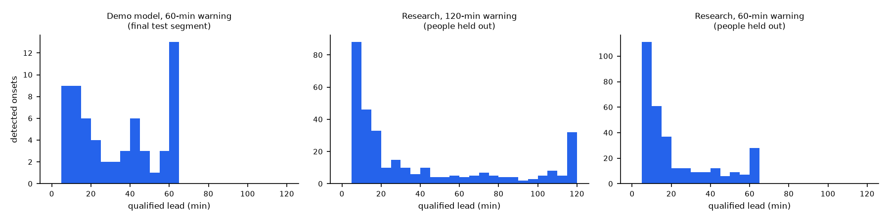

# How much notice the warnings give

From saved forecasts only; nothing fitted, no assessment re-opened. Every onset is a new episode above 180 mg/dL for at least 15 minutes from a below-threshold state; a warning's *qualified lead* is the time from the earliest firing whose own forecast horizon contains the onset. The share columns use **all** eligible onsets as the denominator, so a missed onset counts against them — unlike a median lead among detected onsets.

| Warning | Evaluated on | Onsets | Detected / missed | Warned ≥ 15 min ahead | ≥ 30 min | ≥ 60 min | False alarms per observed day | Precision | Time in warning | Qualified lead, median (IQR) |
|---|---|---|---|---|---|---|---|---|---|---|
| Demo model (fusion LightGBM, personalised), 60 min | final test segment | 64 | 61 / 3 | 67.2 % | 48.4 % | 20.3 % | 1.49 | 0.60 | 11.8 % | 30 (10–55) min |
| Research regression warning (gt-2h-2026-10-20), 120 min, selected per fold, personalised | outer-fold people held out | 329 | 315 / 14 | 55.0 % | 37.4 % | 25.5 % | 1.62 | 0.58 | 10.6 % | 15 (5–65) min |
| Research regression warning (gt-2h-2026-10-20), 60 min, selected per fold, personalised | outer-fold people held out | 329 | 313 / 16 | 42.9 % | 24.3 % | 8.5 % | 1.48 | 0.61 | 7.8 % | 10 (5–30) min |

The demo warning's test segment was inspected, so its row is retrospective; the research rows are people held out entirely but already inspected (internal validation). A 120-minute horizon does not give 120 minutes of notice: most two-hour warnings fire shortly before the onset. Different event definitions or denominators elsewhere do not make a head-to-head comparison.

Regenerate: `uv run --group docs python scripts/warning_utility.py`.
